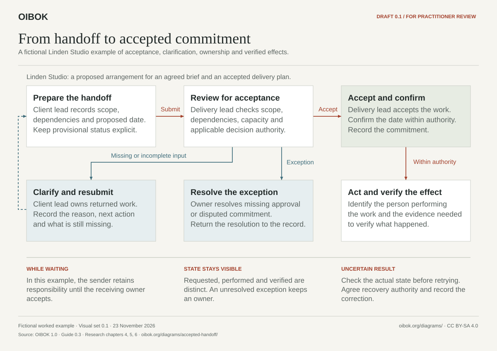

# From handoff to accepted commitment

**DRAFT 0.1 · For practitioner review · 23 November 2026**

A fictional Linden Studio example of acceptance, clarification, ownership and verified effects.

[Open the full-size SVG](/assets/diagrams/accepted-handoff.svg) · [Download the A3 PDF](/downloads/diagrams/accepted-handoff.pdf) · [All diagrams](/diagrams/)

**Fictional worked example.** Linden Studio is wholly fictional. Its proposed change has no recorded implementation, measured benefit or persistence result. General OIBOK guidance requires an agreed owner while a handoff is waiting or disputed; it does not mandate the same owner in every organisation.

## Read the diagram

1. The client lead prepares the brief with scope, requested timing, dependencies and available evidence.
2. The delivery lead checks scope, dependencies and capacity before accepting delivery responsibility. A submitted brief does not itself confirm the commitment.
3. If clarification is needed, the client lead retains responsibility for correction and resubmission in this fictional arrangement. Exceptions requiring authority go to the owner.
4. After acceptance and required authorisation, a date can be confirmed and the work carried through. Performance and verified effects remain distinct.
5. An uncertain action result requires checking the real state before repeating or reversing an action. Keep unresolved work visibly owned.

## Use it with the Guide

[Read this section in the OIBOK Guide (draft 0.6)](/guide/read/#4-clarify-decisions-coordination-and-execution). Use the diagram to support discussion, then record the actual evidence, authority, decision and unresolved conditions in your working records.

- [Practice review](/tools/practice-review/)

The detailed case is [Linden Studio](/guide/read/#a3-linden-studio-non-ai-decision).

## Sources and status

This figure was published with the [archived OIBOK Guide (draft 0.3)](/downloads/guide/OIBOK-Guide-Draft-0.3.pdf). Its research and toolkit sources are OIBOK release 1.0 and Practical Toolkit 0.1. Independent practitioner review and field validation remain pending.

- [OIBOK research Chapter 4: Decision and Authority](/knowledge/decision-and-authority/)
- [OIBOK research Chapter 5: Coordination and Collective Action](/knowledge/coordination-and-collective-action/)
- [OIBOK research Chapter 6: Execution and Operational Reliability](/knowledge/execution-and-operational-reliability/)

Original diagram content is licensed under [CC BY-SA 4.0](/licensing/). Developed by the OIBOK community. Contributors retain copyright and license their original publication contributions to the project.

[Download the complete nine-figure PDF](/downloads/diagrams/OIBOK-Diagrams-Draft-0.1-A3.pdf). Send feedback to [info@oibok.org](mailto:info@oibok.org), identifying “Visual set 0.1”, the diagram and the issue.
