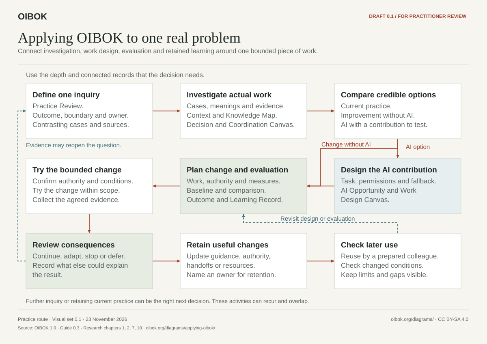

# Applying OIBOK to one real problem

**DRAFT 0.1 · For practitioner review · 23 November 2026**

Connect investigation, work design, evaluation and retained learning around one bounded piece of work.

[Open the full-size SVG](/assets/diagrams/applying-oibok.svg) · [Download the A3 PDF](/downloads/diagrams/applying-oibok.pdf) · [All diagrams](/diagrams/)

**Practice route.** This is a reading and practice aid, not a compulsory sequence of gates. Records can develop together. A non-AI change still needs authority, evaluation and later learning.

## Read the diagram

1. Define the work, desired outcome, affected people, boundary and decision owner.
2. Follow contrasting cases using the Practice Review. Expand its Context and Knowledge Map and Decision and Coordination Canvas where the evidence warrants it.
3. Compare current practice, a credible non-AI improvement and any specific AI contribution. Further inquiry or retaining current practice are legitimate decisions.
4. Use the AI canvas when an AI option proceeds into design. Prepare the Outcome and Learning Record before trying the selected change.
5. Review consequences and competing explanations, record the next decision and embed useful learning in later work. Revisit the problem or design whenever the evidence warrants it.

## Use it with the Guide

[Read this section in the OIBOK Guide (draft 0.6.3)](/guide/read/#quick-start). Use the diagram to support discussion, then record the actual evidence, authority, decision and unresolved conditions in your working records.

- [Practice review](/tools/practice-review/)
- [Ai opportunity and work design](/tools/ai-opportunity-and-work-design/)
- [Outcome and learning](/tools/outcome-and-learning/)

## Sources and status

This figure was published with the [archived OIBOK Guide (draft 0.3)](/downloads/guide/OIBOK-Guide-Draft-0.3.pdf). Its research and toolkit sources are OIBOK release 1.0 and Practical Toolkit 0.1. Independent practitioner review and field validation remain pending.

- [OIBOK research Chapter 1: Signals and Attention](/knowledge/signals-and-attention/)
- [OIBOK research Chapter 2: Organisational Context](/knowledge/organisational-context/)
- [OIBOK research Chapter 7: Outcomes Feedback and Evaluation](/knowledge/outcomes-feedback-and-evaluation/)
- [OIBOK research Chapter 10: Integrated and Responsible Organisational Intelligence](/knowledge/integrated-and-responsible-organisational-intelligence/)

Original diagram content is licensed under [CC BY-SA 4.0](/licensing/). Developed by the OIBOK community. Contributors retain copyright and license their original publication contributions to the project.

[Download the complete nine-figure PDF](/downloads/diagrams/OIBOK-Diagrams-Draft-0.1-A3.pdf). Send feedback to [info@oibok.org](mailto:info@oibok.org), identifying “Visual set 0.1”, the diagram and the issue.
