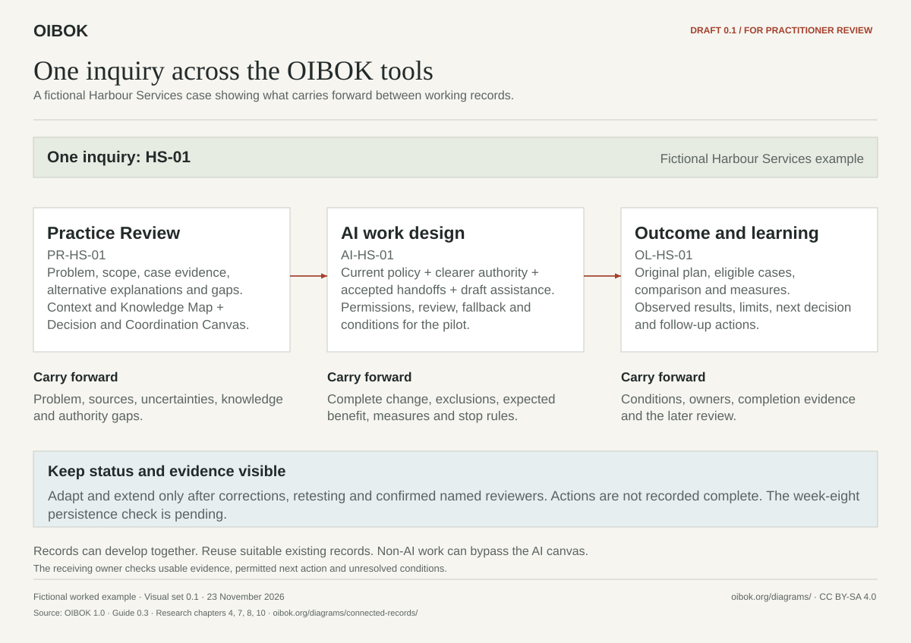

# One inquiry across the OIBOK tools

**DRAFT 0.1 · For practitioner review · 23 November 2026**

A fictional Harbour Services case showing what carries forward between working records.

[Open the full-size SVG](/assets/diagrams/connected-records.svg) · [Download the A3 PDF](/downloads/diagrams/connected-records.pdf) · [All diagrams](/diagrams/)

**Fictional worked example.** The case is fictional. Its adapt-and-extend decision is conditional on corrections, retesting and named reviewers. Follow-up action completion is not yet recorded and the week-eight persistence check remains pending.

## Read the diagram

1. Case HS-01 connects Practice Review PR-HS-01, AI design AI-HS-01 and Outcome and Learning Record OL-HS-01.
2. The review carries forward the problem, boundary, sources, competing explanations and knowledge or authority gaps. Its two supporting maps remain linked to that inquiry.
3. The work design carries the complete intervention, eligible cases, exclusions, comparison, measures, permissions and stop rules into evaluation.
4. The results record carries observations, missing outcomes, limitations, the decision, corrective actions and the later review into continuing practice.
5. The receiving owner checks usable evidence, permitted next action and unresolved conditions. Records can develop together; suitable existing organisational records can be reused.

## Use it with the Guide

[Read this section in the OIBOK Guide (draft 0.6)](/guide/read/#keep-a-small-connected-record). Use the diagram to support discussion, then record the actual evidence, authority, decision and unresolved conditions in your working records.

- [Practice review](/tools/practice-review/)
- [Ai opportunity and work design](/tools/ai-opportunity-and-work-design/)
- [Outcome and learning](/tools/outcome-and-learning/)

See the [OIBOK Working Companion (draft 0.6)](/guide/companion/#3-carry-the-records-forward) for handoff checks and a case index.

## Sources and status

This figure was published with the [archived OIBOK Guide (draft 0.3)](/downloads/guide/OIBOK-Guide-Draft-0.3.pdf). Its research and toolkit sources are OIBOK release 1.0 and Practical Toolkit 0.1. Independent practitioner review and field validation remain pending.

- [OIBOK research Chapter 4: Decision and Authority](/knowledge/decision-and-authority/)
- [OIBOK research Chapter 7: Outcomes Feedback and Evaluation](/knowledge/outcomes-feedback-and-evaluation/)
- [OIBOK research Chapter 8: Organisational Memory Reflection and Learning](/knowledge/organisational-memory-reflection-and-learning/)
- [OIBOK research Chapter 10: Integrated and Responsible Organisational Intelligence](/knowledge/integrated-and-responsible-organisational-intelligence/)

Original diagram content is licensed under [CC BY-SA 4.0](/licensing/). Developed by the OIBOK community. Contributors retain copyright and license their original publication contributions to the project.

[Download the complete nine-figure PDF](/downloads/diagrams/OIBOK-Diagrams-Draft-0.1-A3.pdf). Send feedback to [info@oibok.org](mailto:info@oibok.org), identifying “Visual set 0.1”, the diagram and the issue.
