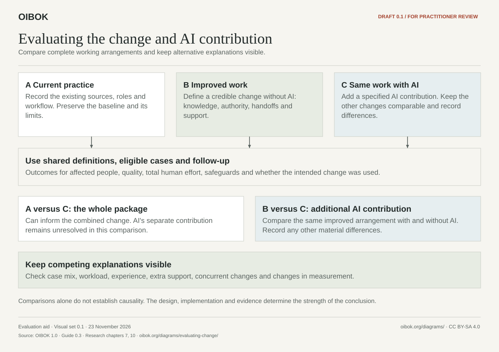

# Evaluating the change and AI contribution

**DRAFT 0.1 · For practitioner review · 23 November 2026**

Compare complete working arrangements and keep alternative explanations visible.

[Open the full-size SVG](/assets/diagrams/evaluating-change.svg) · [Download the A3 PDF](/downloads/diagrams/evaluating-change.pdf) · [All diagrams](/diagrams/)

**Evaluation aid.** A three-column comparison is not itself a causal evaluation design. Selection, allocation, missing outcomes and other design features determine what the evidence supports. A local workflow result does not establish organisation-wide intelligence.

## Read the diagram

1. Arrangement A is current practice. Arrangement B is an improved working arrangement without AI. Arrangement C adds AI to the same improved arrangement.
2. A comparison of A and C examines the complete package. A comparison of B and C is relevant to the additional contribution of AI.
3. Use comparable definitions and observation periods. Assess beneficiary outcomes, quality, total effort, safeguards and whether the intended arrangement was used.
4. Consider case mix, workload, extra expert support, staff learning, concurrent changes and measurement changes as possible explanations.
5. Attach the conclusion to the tested setting, people, cases, period and configuration. Record the accountable decision to continue, adapt, stop or defer.

## Use it with the Guide

[Read this section in the OIBOK Guide (draft 0.6.1)](/guide/read/#6-evaluate-the-change). Use the diagram to support discussion, then record the actual evidence, authority, decision and unresolved conditions in your working records.

- [Outcome and learning](/tools/outcome-and-learning/)

## Sources and status

This figure was published with the [archived OIBOK Guide (draft 0.3)](/downloads/guide/OIBOK-Guide-Draft-0.3.pdf). Its research and toolkit sources are OIBOK release 1.0 and Practical Toolkit 0.1. Independent practitioner review and field validation remain pending.

- [OIBOK research Chapter 7: Outcomes Feedback and Evaluation](/knowledge/outcomes-feedback-and-evaluation/)
- [OIBOK research Chapter 10: Integrated and Responsible Organisational Intelligence](/knowledge/integrated-and-responsible-organisational-intelligence/)

Original diagram content is licensed under [CC BY-SA 4.0](/licensing/). Developed by the OIBOK community. Contributors retain copyright and license their original publication contributions to the project.

[Download the complete nine-figure PDF](/downloads/diagrams/OIBOK-Diagrams-Draft-0.1-A3.pdf). Send feedback to [info@oibok.org](mailto:info@oibok.org), identifying “Visual set 0.1”, the diagram and the issue.
