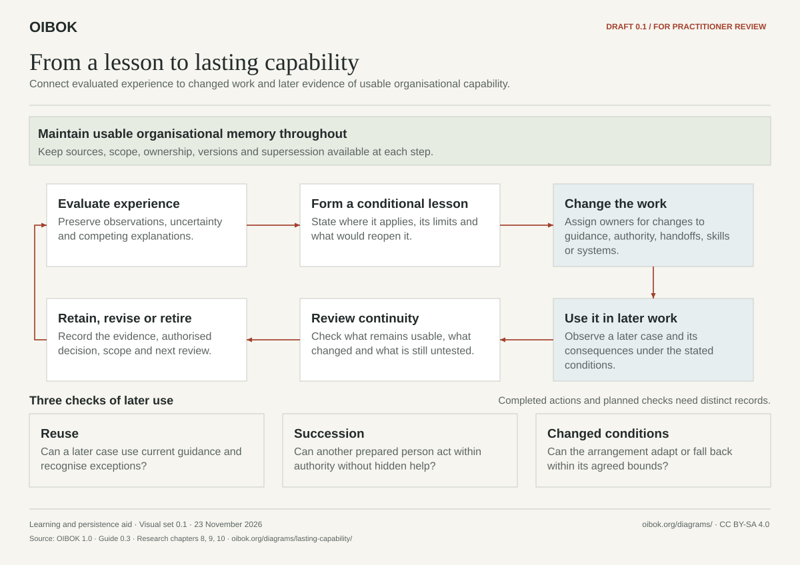

# From a lesson to lasting capability

**DRAFT 0.1 · For practitioner review · 23 November 2026**

Connect evaluated experience to changed work and later evidence of usable organisational capability.

[Open the full-size SVG](/assets/diagrams/lasting-capability.svg) · [Download the A3 PDF](/downloads/diagrams/lasting-capability.pdf) · [All diagrams](/diagrams/)

**Learning and persistence aid.** The three practical checks are proposed inquiry prompts, not a validated score or universal measurement threshold. A planned check remains planned until evidence is recorded. Continuity can include explicit ongoing dependencies.

## Read the diagram

1. Form a challengeable lesson from evaluated experience, with supporting evidence, uncertainty and conditions of applicability.
2. Translate it into working arrangements: guidance, decision rights, handoffs, system configuration, expertise or resources. Assign owners and completion evidence.
3. Place current knowledge where the next relevant decision can use it. Preserve source, scope, version, review condition and supersession.
4. Examine later reuse, another suitably prepared person doing the work, and relevant changed conditions. Choose safe cases or rehearsals when needed.
5. Retain, revise or retire arrangements in light of the evidence. Separate a completed action from capability demonstrated over the horizon of the claim.

## Use it with the Guide

[Read this section in the OIBOK Guide (draft 0.6.2)](/guide/read/#7-turn-experience-into-lasting-capability). Use the diagram to support discussion, then record the actual evidence, authority, decision and unresolved conditions in your working records.

- [Outcome and learning](/tools/outcome-and-learning/)

## Sources and status

This figure was published with the [archived OIBOK Guide (draft 0.3)](/downloads/guide/OIBOK-Guide-Draft-0.3.pdf). Its research and toolkit sources are OIBOK release 1.0 and Practical Toolkit 0.1. Independent practitioner review and field validation remain pending.

- [OIBOK research Chapter 8: Organisational Memory Reflection and Learning](/knowledge/organisational-memory-reflection-and-learning/)
- [OIBOK research Chapter 9: Capability Development and Adaptation](/knowledge/capability-development-and-adaptation/)
- [OIBOK research Chapter 10: Integrated and Responsible Organisational Intelligence](/knowledge/integrated-and-responsible-organisational-intelligence/)

Original diagram content is licensed under [CC BY-SA 4.0](/licensing/). Developed by the OIBOK community. Contributors retain copyright and license their original publication contributions to the project.

[Download the complete nine-figure PDF](/downloads/diagrams/OIBOK-Diagrams-Draft-0.1-A3.pdf). Send feedback to [info@oibok.org](mailto:info@oibok.org), identifying “Visual set 0.1”, the diagram and the issue.
