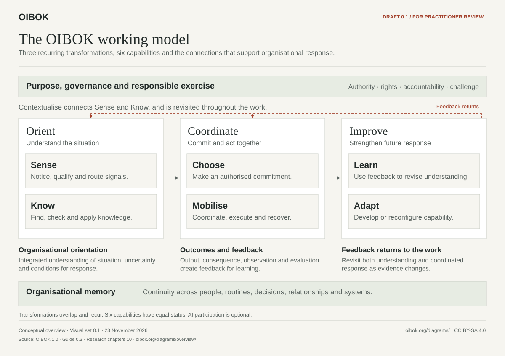

# The OIBOK working model

**DRAFT 0.1 · For practitioner review · 23 November 2026**

Three recurring transformations, six capabilities and the connections that support organisational response.

[Open the full-size SVG](/assets/diagrams/overview.svg) · [Download the A3 PDF](/downloads/diagrams/overview.pdf) · [All diagrams](/diagrams/)

**Conceptual overview.** The transformations overlap and recur. The six capabilities have equal status. AI participation is optional. The model is a literature-grounded working synthesis, with independent field validation pending.

## Read the diagram

1. Orient brings relevant signals and knowledge into an understanding of the situation. Sense and Know are its two capabilities.
2. Coordinate connects authorised commitment and collective response through Choose and Mobilise.
3. Improve uses evaluated consequences to revise understanding and capability through Learn and Adapt.
4. Contextualise is a connective mechanism and organisational orientation is an integrated state. They are not additional capabilities.
5. Memory supplies continuity across the work. Purpose, governance and responsible exercise span every capability. Feedback can return to both Orient and Coordinate.

## Use it with the Guide

[Read this section in the OIBOK Guide (draft 0.6.3)](/guide/read/#1-understand-organisational-intelligence). Use the diagram to support discussion, then record the actual evidence, authority, decision and unresolved conditions in your working records.

- [OIBOK Guide (draft 0.6.3) downloads](/guide/)

## Sources and status

This figure was published with the [archived OIBOK Guide (draft 0.3)](/downloads/guide/OIBOK-Guide-Draft-0.3.pdf). Its research and toolkit sources are OIBOK release 1.0 and Practical Toolkit 0.1. Independent practitioner review and field validation remain pending.

- [OIBOK research Chapter 10: Integrated and Responsible Organisational Intelligence](/knowledge/integrated-and-responsible-organisational-intelligence/)

Original diagram content is licensed under [CC BY-SA 4.0](/licensing/). Developed by the OIBOK community. Contributors retain copyright and license their original publication contributions to the project.

[Download the complete nine-figure PDF](/downloads/diagrams/OIBOK-Diagrams-Draft-0.1-A3.pdf). Send feedback to [info@oibok.org](mailto:info@oibok.org), identifying “Visual set 0.1”, the diagram and the issue.
