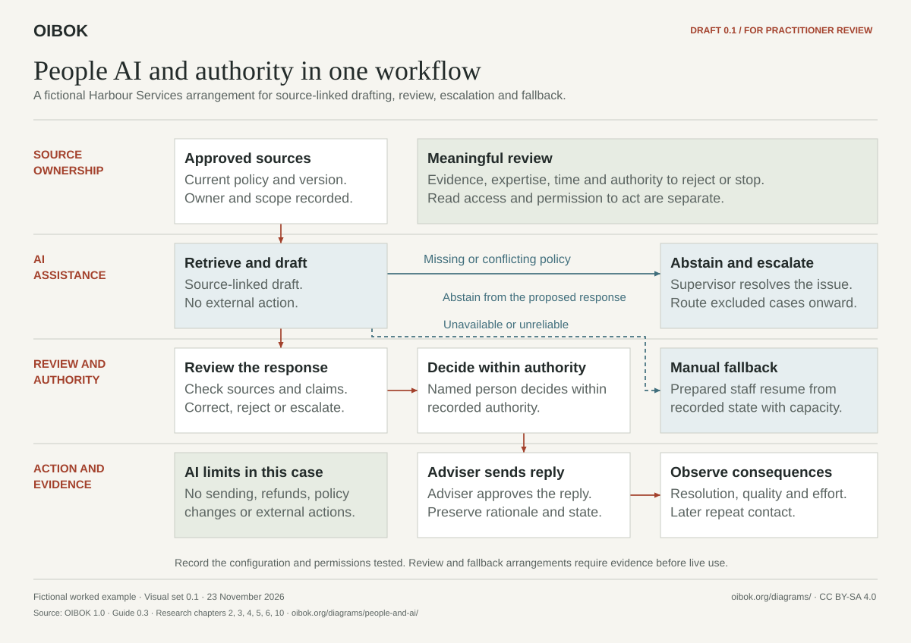

# People AI and authority in one workflow

**DRAFT 0.1 · For practitioner review · 23 November 2026**

A fictional Harbour Services arrangement for source-linked drafting, review, escalation and fallback.

[Open the full-size SVG](/assets/diagrams/people-and-ai.svg) · [Download the A3 PDF](/downloads/diagrams/people-and-ai.pdf) · [All diagrams](/diagrams/)

**Fictional worked example.** This is the fictional Harbour configuration, not a universal prohibition on authorised AI actions in other settings. Proposed controls require evidence that they operate as intended.

## Read the diagram

1. The policy owner maintains the governing source, current version and route for resolving ambiguity.
2. AI retrieves approved material and prepares a draft. Its technical ability creates no permission to decide or act.
3. A named adviser checks the source, version, context and proposed response within their authority. Meaningful review needs evidence, expertise, time and power to reject or stop.
4. Missing or conflicting policy requires abstention and escalation. Excluded cases leave the standard workflow. The established manual process is the fallback.
5. An authorised person approves the external reply and records what happened. In this example AI cannot send replies, approve refunds, change policy or act externally.

## Use it with the Guide

[Read this section in the OIBOK Guide (draft 0.7)](/guide/read/#5-design-how-people-and-ai-work-together). Use the diagram to support discussion, then record the actual evidence, authority, decision and unresolved conditions in your working records.

- [Ai opportunity and work design](/tools/ai-opportunity-and-work-design/)

The detailed case is [Harbour Services](/guide/read/#a1-harbour-services).

## Sources and status

This figure was published with the [archived OIBOK Guide (draft 0.3)](/downloads/guide/OIBOK-Guide-Draft-0.3.pdf). Its research and toolkit sources are OIBOK release 1.0 and Practical Toolkit 0.1. Independent practitioner review and field validation remain pending.

- [OIBOK research Chapter 2: Organisational Context](/knowledge/organisational-context/)
- [OIBOK research Chapter 3: Knowledge and Expertise](/knowledge/knowledge-and-expertise/)
- [OIBOK research Chapter 4: Decision and Authority](/knowledge/decision-and-authority/)
- [OIBOK research Chapter 5: Coordination and Collective Action](/knowledge/coordination-and-collective-action/)
- [OIBOK research Chapter 6: Execution and Operational Reliability](/knowledge/execution-and-operational-reliability/)
- [OIBOK research Chapter 10: Integrated and Responsible Organisational Intelligence](/knowledge/integrated-and-responsible-organisational-intelligence/)

Original diagram content is licensed under [CC BY-SA 4.0](/licensing/). Developed by the OIBOK community. Contributors retain copyright and license their original publication contributions to the project.

[Download the complete nine-figure PDF](/downloads/diagrams/OIBOK-Diagrams-Draft-0.1-A3.pdf). Send feedback to [info@oibok.org](mailto:info@oibok.org), identifying “Visual set 0.1”, the diagram and the issue.
