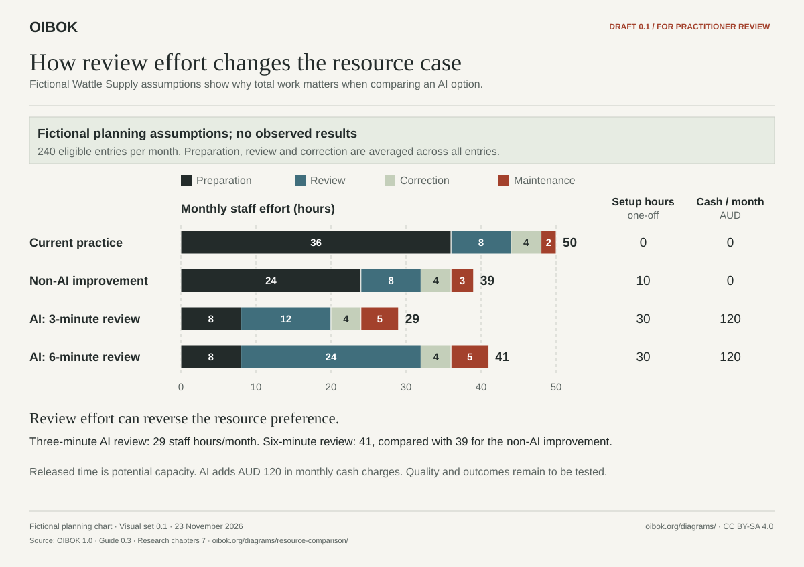

# How review effort changes the resource case

**DRAFT 0.1 · For practitioner review · 23 November 2026**

Fictional Wattle Supply assumptions show why total work matters when comparing an AI option.

[Open the full-size SVG](/assets/diagrams/resource-comparison.svg) · [Download the A3 PDF](/downloads/diagrams/resource-comparison.pdf) · [All diagrams](/diagrams/)

**Fictional planning chart.** All volumes, times and charges are invented teaching inputs. There are no observed results. Setup effort, recurring staff-time value and cash expenditure are separate quantities.

## Read the diagram

1. The comparison assumes 240 eligible catalogue entries per month. Preparation, review and correction minutes are converted to staff hours, then monthly maintenance is added.
2. Current practice totals 50 staff hours. The non-AI improvement totals 39. Adding AI with three-minute review totals 29. Increasing AI review to six minutes totals 41.
3. The AI option includes the non-AI improvements. Its setup is 30 staff hours in total, compared with 10 for the non-AI improvement, and it adds AUD 120 in monthly cash charges.
4. The difference represents potential released capacity, not an assumed payroll saving. Accuracy, quality, turnaround and redeployability still need evaluation.
5. Replace the assumptions with actual case evidence before authorising a material decision. Preserve original assumptions so later findings can challenge them.

## Use it with the Guide

[Read this section in the OIBOK Guide (draft 0.5)](/guide/read/#a2-wattle-supply-business-decision). Use the diagram to support discussion, then record the actual evidence, authority, decision and unresolved conditions in your working records.

- [Ai opportunity and work design](/tools/ai-opportunity-and-work-design/)
- [Outcome and learning](/tools/outcome-and-learning/)

## Planning inputs and calculated hours

All entries below are fictional. Hours are monthly staff effort; setup is a separate one-off allowance.

| Scenario | Preparation | Review | Correction | Maintenance | Total hours | Setup hours | Extra cash per month |
| --- | ---: | ---: | ---: | ---: | ---: | ---: | ---: |
| Current practice | 36 | 8 | 4 | 2 | 50 | 0 | AUD 0 |
| Non-AI improvement | 24 | 8 | 4 | 3 | 39 | 10 | AUD 0 |
| AI with 3-minute review | 8 | 12 | 4 | 5 | 29 | 30 | AUD 120 |
| AI with 6-minute review | 8 | 24 | 4 | 5 | 41 | 30 | AUD 120 |

The AI setup already includes the non-AI changes. Potential released staff time is not a cash saving. No reduction in payroll, overtime or contractor expenditure is assumed.

## Sources and status

This figure was published with the [archived OIBOK Guide (draft 0.3)](/downloads/guide/OIBOK-Guide-Draft-0.3.pdf). Its research and toolkit sources are OIBOK release 1.0 and Practical Toolkit 0.1. Independent practitioner review and field validation remain pending.

- [OIBOK research Chapter 7: Outcomes Feedback and Evaluation](/knowledge/outcomes-feedback-and-evaluation/)

Original diagram content is licensed under [CC BY-SA 4.0](/licensing/). Developed by the OIBOK community. Contributors retain copyright and license their original publication contributions to the project.

[Download the complete nine-figure PDF](/downloads/diagrams/OIBOK-Diagrams-Draft-0.1-A3.pdf). Send feedback to [info@oibok.org](mailto:info@oibok.org), identifying “Visual set 0.1”, the diagram and the issue.
