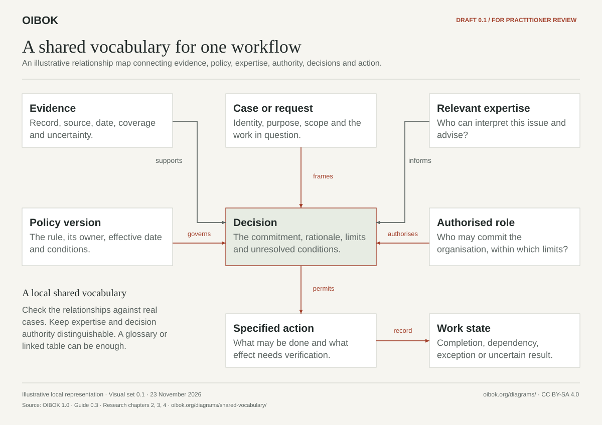

# A shared vocabulary for one workflow

**DRAFT 0.1 · For practitioner review · 23 November 2026**

An illustrative relationship map connecting evidence, policy, expertise, authority, decisions and action.

[Open the full-size SVG](/assets/diagrams/shared-vocabulary.svg) · [Download the A3 PDF](/downloads/diagrams/shared-vocabulary.pdf) · [All diagrams](/diagrams/)

**Illustrative local representation.** This is an illustrative local representation, not a canonical or validated OIBOK ontology. A graph database is optional. The relationships must be checked against the work and its actual authority.

## Read the diagram

1. A case or request provides the work and purpose that the decision concerns.
2. Evidence supports the decision, while a policy version governs it under stated conditions. Retain provenance, currentness and uncertainty.
3. Relevant expertise informs the interpretation. An authorised role may commit the organisation within stated limits. These are different relationships even when one person holds both roles.
4. The decision permits specified action. The work state records completion, dependency, exception or an uncertain result.
5. Test the vocabulary against contrasting real cases, assign ownership and preserve meaningful differences. A glossary or linked table can support the same inquiry.

## Use it with the Guide

[Read the relevant Guide section](/guide/read/#agree-a-small-shared-vocabulary). Use the diagram to support discussion, then record the actual evidence, authority, decision and unresolved conditions in your working records.

- [Practice review](/tools/practice-review/)

## Sources and status

This draft visual is based on OIBOK release 1.0, Guide 0.3 and Practical Toolkit 0.1. It explains the existing working synthesis and practice guidance. Independent practitioner review and field validation remain pending.

- [OIBOK research Chapter 2: Organisational Context](/knowledge/organisational-context/)
- [OIBOK research Chapter 3: Knowledge and Expertise](/knowledge/knowledge-and-expertise/)
- [OIBOK research Chapter 4: Decision and Authority](/knowledge/decision-and-authority/)

Original diagram content is licensed under [CC BY-SA 4.0](/licensing/). Developed by the OIBOK community. Contributors retain copyright and license their original publication contributions to the project.

[Download the complete nine-figure PDF](/downloads/diagrams/OIBOK-Diagrams-Draft-0.1-A3.pdf). Send feedback to [info@oibok.org](mailto:info@oibok.org), identifying “Visual set 0.1”, the diagram and the issue.
