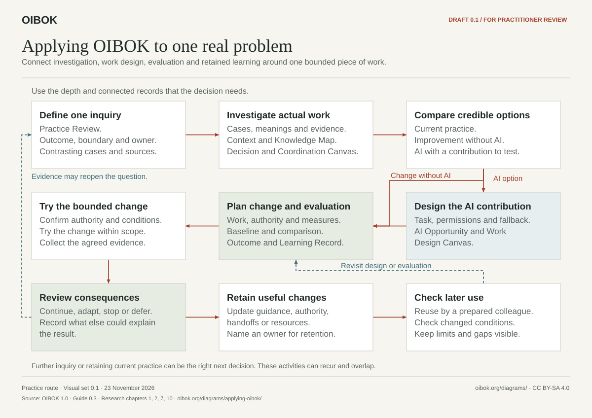
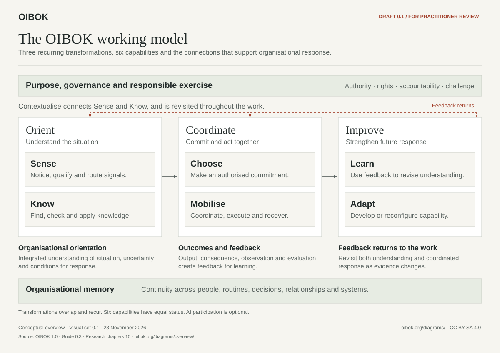
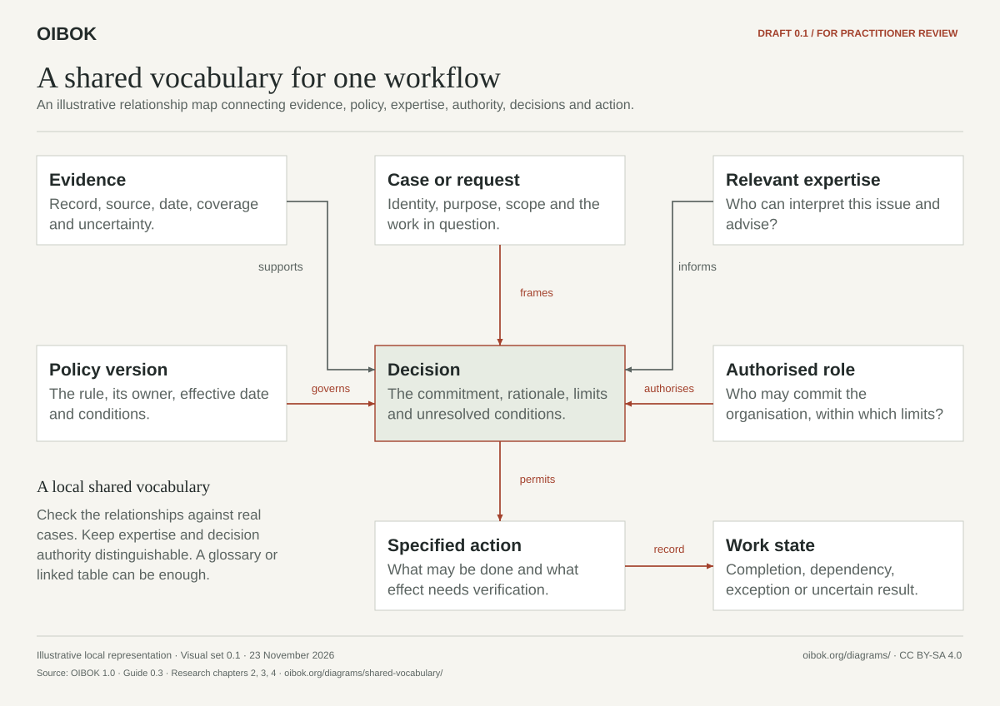
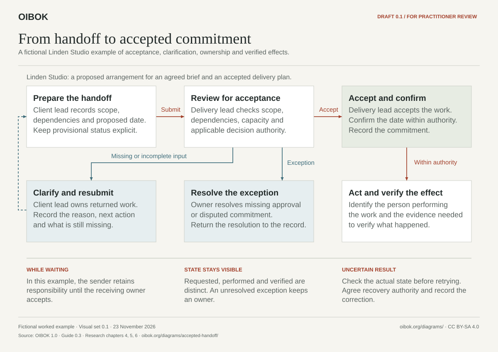
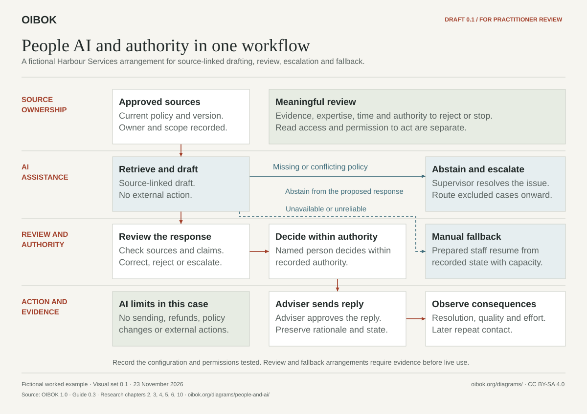
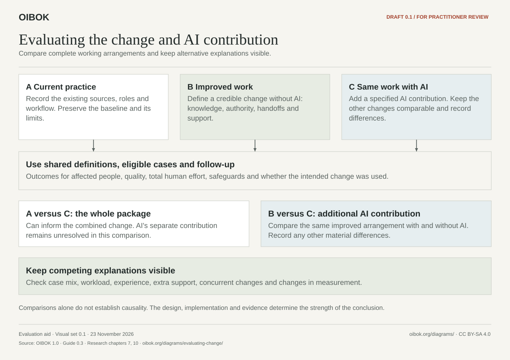
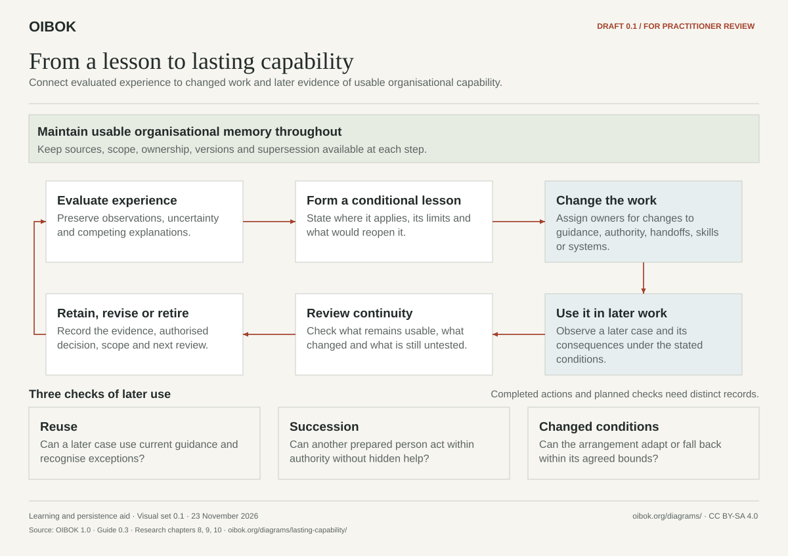
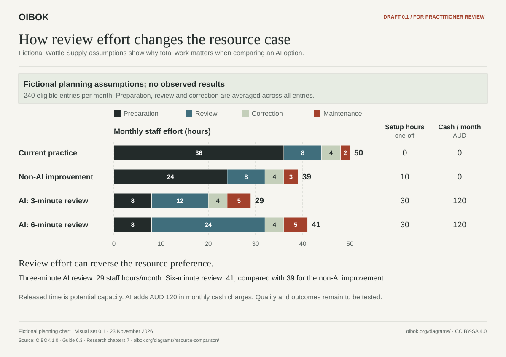
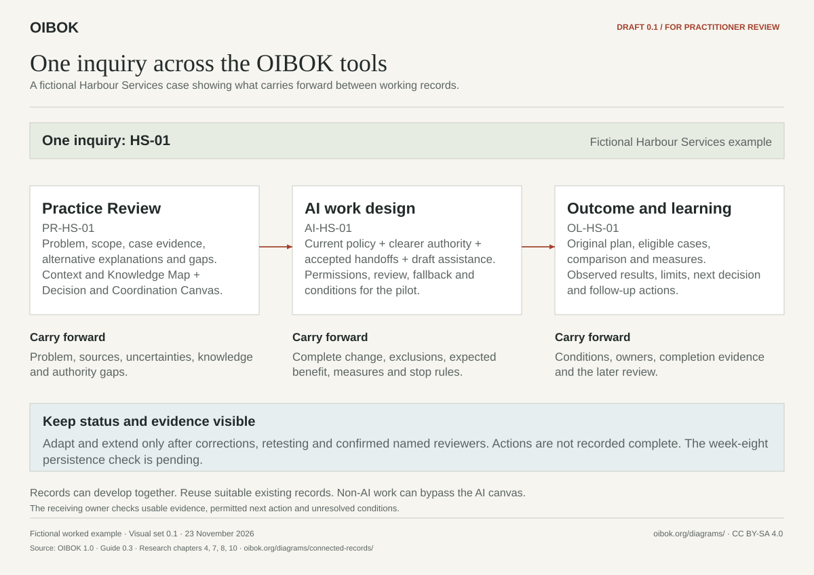

# The OIBOK Guide

**Applying Organisational Intelligence in Practice**

Guide 0.7 | DRAFT · For practitioner review

28 November 2026

Organisation Intelligence Body of Knowledge

oibok.org

## Purpose and publication status

A customer has agreed to a quote, but the job still cannot be booked. Sales thinks its part is finished. Scheduling says it needs more information. Everyone is busy, and the customer is still waiting.

The fictional Silvergum example follows a problem like this. The Guide helps you investigate similar situations in your own organisation: what happened, what people needed, who could decide and what would make the next case work better.

Start with one piece of work. Use the research where you need a fuller explanation and the worksheets where you need to record a decision. You can use the Guide to examine an AI proposal, clarify responsibilities or make a change that does not involve AI.

The complete Guide includes four main fictional cases, short worked examples, nine draft diagrams and links to the Working Companion. The [Silvergum case pack](https://oibok.org/guide/silvergum/) shows how the records connect from the first investigation to later reviews and a change of owner.

**Publication status.** Guide 0.7 is based on OIBOK release 1.0 and Practical Toolkit 0.1. OIBOK is a literature-grounded working synthesis. External practitioner review, field application and independent validation of the complete model and Guide remain pending. The Guide provides no certification, validated intelligence score or assurance of compliance with another standard. [Release record](https://oibok.org/research/release-record/) · [Research methodology](https://oibok.org/methodology/).

**Preparation.** AI tools assisted with writing and editing. This edition rewrites Chapters 3–8 for practical use and incorporates the separate Chapter 6 review copy after editorial reconciliation. It retains the [27 November evidence-watch applications](https://oibok.org/research/evidence-watch-2026-11-27/) and their source limits. Independent editorial review, practitioner testing and field validation remain pending. [Research methods and AI use](https://oibok.org/methodology/#how-ai-was-used-to-develop-oibok).

## Publication rights

Copyright in original contributions remains with their respective authors and contributors. Original text in this guide is licensed under **Creative Commons Attribution-ShareAlike 4.0 International**, unless a separate notice states otherwise. Contributors retain copyright and license their original publication contributions to the project under those terms. [\[L\]](https://oibok.org/licensing/)

You may copy and adapt the licensed material, including for commercial use. When sharing it, provide appropriate credit, link to the licence and identify changes. Share adapted publication content under the same licence or a permitted compatible licence. The legal code governs these permissions. Citations do not relicense third-party sources. Official names and brand assets are excluded from the publication licence, which does not grant trademark rights or imply endorsement. [\[CC\]](https://creativecommons.org/licenses/by-sa/4.0/) [\[L\]](https://oibok.org/licensing/)

You can keep completed organisational worksheets and private adaptations in your organisation's authorised workspace. Do not include confidential records in a public contribution. See the publication licensing page for scope and exceptions. [\[L\]](https://oibok.org/licensing/)

## Quick start

### Pick one problem you can follow

Choose a recurring piece of work that is causing difficulty: a complaint that keeps coming back, a purchase waiting for approval or a job passed between teams without anyone knowing what happens next.

Write the question you want to answer. For example: “How can we resolve standard complaints accurately, with fewer delays and repeat contacts?” Say where the work starts, where it ends and who is affected. Keep the question small enough to investigate.

Invite someone who owns the work, someone who does it and someone who receives the result. Bring in other expertise where you need help judging the evidence. Make sure a person with authority to change the work will receive the findings, even if they cannot attend every discussion. [Toolkit guidance](https://oibok.org/tools/guide/) · [Practice Review](https://oibok.org/tools/practice-review/).

**Figure. Applying OIBOK to one real problem.** Draft practice illustration. Connect the inquiry, working records, chosen change and evaluation. AI is optional. Revisit earlier questions when evidence or conditions change; further inquiry and retaining current practice remain legitimate decisions. [Open the figure and full-size downloads](https://oibok.org/diagrams/applying-oibok/).

### Bring cases, then follow what happened

Open the [Practice Review](https://oibok.org/tools/practice-review/). Bring a case that went well and one that was delayed, disputed or recovered from an error. Use the records and instructions available at the time. Note how you chose the cases; a few examples cannot tell you how often a problem happens across the organisation.

Follow each case from the first request through to its outcome. Ask:

- What first needed someone's attention?
- What did the people involved know, and what were they missing?
- Who could make the decision?
- What did the next person need to carry on?
- What happened to the person waiting for the result?

Use the [Context and Knowledge Map](https://oibok.org/tools/practice-review/#context-and-knowledge-map) to record sources, expertise and gaps. Use the [Decision and Coordination Canvas](https://oibok.org/tools/practice-review/#decision-and-coordination-canvas) to record who can decide, who depends on whom and what counts as an accepted handoff. Both are part of the Practice Review and are available as separate A3 canvases.

Keep what you observed separate from your explanation. “The receiving team returned seven cases” is an observation if the records support it. “Staff need more training” is a possible explanation. Check what else could account for the returns before choosing a fix.

### Decide what is worth trying

Describe the result you want and the conditions you must protect, such as accuracy, safety or the workload of another team. Compare the current way of working with a credible improvement that does not use AI. Consider AI when you can name a useful contribution to test, such as finding a source or preparing a draft.

If you take an AI option forward, use the [AI Opportunity and Work Design Canvas](https://oibok.org/tools/ai-opportunity-and-work-design/). Specify what the system can access, produce and do. Name the role that can authorise a consequential action. Decide when the system should decline to proceed and how people will continue if it fails.

“Someone will check it” is not enough to design the review. That person needs the expertise, time and authority to change or stop the result. [Chapter 5](https://oibok.org/guide/people-and-ai/) explains the work design in more detail.

If your change does not involve AI, move to [Chapter 6](https://oibok.org/guide/evaluate/) and the Outcome and Learning Record. You can also decide to gather more evidence or keep the current arrangement.

### Agree how you will judge the change

Before starting, open the [Outcome and Learning Record](https://oibok.org/tools/outcome-and-learning/). Record what you will change, what you will compare it with and how long you need to observe the result. Define which cases count, who will collect the evidence and how you will handle missing or incomplete records.

Include quality, total effort, delays, adverse effects and the experience of people who depend on the work. A faster task may still leave another team with more checking or repair work.

Agree what would justify continuing, adapting, pausing or stopping. Match the evidence to the decision: a small trial might justify another limited test without supporting a wider rollout. Set the review date and name the decision owner.

### Review the result and make the next decision

Check whether people used the change as intended and whether the outcome improved. Ask what else might explain the result. Record the decision, the reasons, the next action and its owner.

Put useful learning where people can use it. That might mean correcting a source, clarifying who can approve a change, revising a handoff or testing a recovery procedure. Return later to see whether it still works, including when a different person takes over. [Outcome and Learning Record](https://oibok.org/tools/outcome-and-learning/) · [Organisational memory and learning](https://oibok.org/knowledge/organisational-memory-reflection-and-learning/) · [Capability development and adaptation](https://oibok.org/knowledge/capability-development-and-adaptation/).

**Aim to leave with a decision supported by evidence, an owner for the next action and a record another colleague can understand.** Explain which worksheet prompts do not apply and keep unanswered questions visible.

[See the application diagram and downloads](https://oibok.org/diagrams/applying-oibok/) · [Follow the completed fictional Silvergum case](https://oibok.org/guide/silvergum/).

## How to use this guide

Guide 0.7 is the Plain-language practice edition. Chapters 3–8 now follow the case, the decision and the next working record in more direct language. Chapter 6 incorporates its separate review draft and the complete fictional booking decision. The full reading view and downloads contain the same Guide text.

The coordination, knowledge, shared-understanding and recovery checks introduced in Guide 0.6.3 remain. The [dated evidence appraisal](https://oibok.org/research/evidence-watch-2026-11-27/) explains their sources and limits. The working model, seven provisional diagnostic classes and fictional case results are retained.

The workforce development and pilot guidance from Guide 0.6.2 remains available. Chapter 7 asks how people will enter changed roles, gain supervised experience and become the experienced practitioners the work will need later. The [Workforce Development Review](https://oibok.org/tools/workforce-development-review/) connects these questions to existing records, and the [proposed pilot](https://oibok.org/research/workforce-development-pilot/) sets out a route for testing their usefulness.

Use the role labels to assign responsibilities in your own team. The **work owner** follows the work and its outcome. The **decision owner** has authority to make the particular commitment. The **evidence owner** arranges the records, definitions and collection needed for the review. A **source owner** keeps the relevant guidance or knowledge current. Name the person for each responsibility; one person may hold several where your organisation permits it. Bring in the people doing and receiving the work as well as those with these responsibilities. Chapter 2A keeps its number so earlier references still work.

Read Chapters 1 and 2 to establish the model and select the work. Chapters 3 to 5 help investigate and design the response. Chapters 6 to 8 address evaluation, persistence and extension. Use Chapter 2A to test competing explanations before choosing a change. Appendix A follows Harbour Services through the approach, compares three catalogue workflow options for Wattle Supply and examines a non-AI decision at Linden Studio. Silvergum Field Services in A4 illustrates later use by a new owner and links to the two-team decision in Chapter 8. Appendix B helps a facilitator prepare the sessions. Appendix C maps each guide chapter to the research and tools, and Appendix D identifies the source versions.

The reading order is a practical aid. In real work you may revisit the problem after examining the evidence, redesign the intervention after an exception, or revise the measures when the intended outcome becomes clearer. Record significant revisions rather than making the earlier rationale disappear.

The guide uses four distinct kinds of material. **Model statements** describe the current OIBOK working synthesis and cite its owning chapter. **Practice guidance** proposes how to apply that synthesis and the toolkit. **External guidance** is identified by source and version. **Illustrative examples** explain a method using invented situations or data. None of these labels turns an example into empirical evidence.

References such as O4 or T2 identify the research chapter or tool supporting a passage. The references are linked and listed in Appendix D. Follow the research chapter when you need its argument, bibliography, competing accounts or limits. Use the separate source record at the cited repository revision when exact version history matters.

## Choose the depth of the review

Choose the smallest review that can support the decision. These proposed routes consider consequences, reversibility, dependencies and uncertainty, with no numerical readiness score.

For every route, use a Practice Review and an Outcome and Learning Record for a selected change, reusing suitable records. Name an action owner and a later review point. Expand the supporting maps where gaps matter. [\[T0\]](https://oibok.org/tools/guide/) [\[T1\]](https://oibok.org/tools/practice-review/) [\[T3\]](https://oibok.org/tools/outcome-and-learning/)

| Route | People and minimum connected record | Decision and escalation |
| --- | --- | --- |
| **Small reversible change** within existing authority | Work owner, a worker and a recipient, with relevant expertise. Record the inquiry, contrasting cases, sources, competing explanations, proposed change, authority and outcome check. | Try the limited change, investigate or retain current practice. Deepen the review if authority is unclear, effects extend beyond the boundary or reversal is uncertain. |
| **Bounded AI pilot** in a reviewed workflow | Work owner, workers, knowledge and systems owners, evidence owner and affected users where relevant. Connect the Practice Review, AI canvas and evaluation plan. Cover alternatives, permissions, review, fallback and stop conditions. | Authorise a limited pilot when conditions are evidenced, choose a non-AI change, investigate or stop. Escalate missing evidence, inadequate review capacity, exceeded delegation or a stop condition. |
| **Consequential cross-team work** with interdependent commitments or effects difficult to reverse | Accountable decision owner, affected workflow owners and recipients, relevant specialists and evidence owner. Connect case evidence, dependencies, decision rights, affected outcomes, options, resources, approvals, recovery and evaluation. | Make a bounded commitment, commission inquiry, adapt or defer. Escalate unresolved ownership, conflicting constraints, consequences beyond authority or specialist evaluation and recovery needs. |

Complete the AI canvas when taking AI forward into work design or a pilot, including in consequential cross-team work. If the initial review defers AI before design, record the reasons in the Practice Review and revisit them if AI becomes a candidate again. [\[T2\]](https://oibok.org/tools/ai-opportunity-and-work-design/)

Roles may be combined while required separation of responsibilities remains applicable. Record unresolved conditions, owners and evidence needed; revisit the route when circumstances change. Chapters 3 to 8 develop the methods. The Working Companion provides preparation, handoff and retention checks.

### From a question to a recorded decision

Use this route alongside the depth selector. The minimum is a bounded Practice Review and an Outcome and Learning Record for a selected change. Expand the supporting maps where the decision needs them. Invite the people who supply or receive the work, not only the proposal sponsor. The linked Silvergum records are completed fictional examples; start your own inquiry from the blank tools.

| Stage and reading | Complete with whom | Decision or output |
| --- | --- | --- |
| Frame and diagnose · Chapters 2 and 2A | Work performer, receiver, decision owner and evidence owner; [Practice Review scope and evidence worksheet](https://oibok.org/tools/practice-review/#scope-and-evidence-worksheet) and [Companion diagnostic record](https://oibok.org/guide/companion/#run-a-diagnostic-review) | Bounded question, sources, rival explanations and next evidence. See [Silvergum SG-01](https://oibok.org/guide/silvergum/#2-completed-practice-review-sg-01). |
| Understand the work · Chapter 3 | People doing and receiving the work, source owners and relevant experts; [Context and Knowledge Map](https://oibok.org/tools/practice-review/#context-and-knowledge-map) | Usable sources, conflicting meanings, missing context and owners for correction. |
| Establish authority and handoffs · Chapter 4 | Sender, receiver, decision owner and exception owner; [Decision and Coordination Canvas](https://oibok.org/tools/practice-review/#decision-and-coordination-canvas) | Accepted commitment, decision limits, holding owner and recovery route. |
| Compare and design · Chapter 5 | Work and service owners, affected teams and relevant AI/data specialists; [improvement worksheet](https://oibok.org/tools/practice-review/#improvement-and-handoff-worksheet), plus [AI canvas](https://oibok.org/tools/ai-opportunity-and-work-design/) if AI proceeds | Credible options and a justified design or further inquiry. Deferring AI is a valid recorded outcome. |
| Plan then evaluate · Chapter 6 | Decision owner, evidence owner, workers and affected receivers; [Outcome and Learning Record](https://oibok.org/tools/outcome-and-learning/#evaluation-plan) | Original plan, complete comparison, limits and continue/adapt/stop/further-evidence decision. See [OL-SG-01](https://oibok.org/guide/silvergum/#4-completed-outcome-and-learning-record-ol-sg-01). |
| Retain and check · Chapter 7 | Source owner, outgoing and incoming workers, authority holder; [learning and persistence fields](https://oibok.org/tools/outcome-and-learning/#check-that-learning-persists) and [Companion ownership record](https://oibok.org/guide/companion/#record-an-exception-and-transfer-ownership) | Changed practice, tested access and authority, later evidence and next review. See [EX-SG-02](https://oibok.org/guide/silvergum/#ex-sg-02-ownership-transfer-at-week-eight). |
| Extend across teams · Chapter 8 | Both receiving teams and the owner of shared service/resource decisions; [Companion cross-team record](https://oibok.org/guide/companion/#agree-the-cross-team-decision) | Common meanings, local decisions and conditions for extension. See [CT-SG-01](https://oibok.org/guide/silvergum/#6-completed-cross-team-decision-ct-sg-01). |

Do not wait for every meeting to finish before preserving evidence, and do not complete an outcome review before its observation window closes. One person may hold several roles; record who accepts each responsibility and any separation the organisation requires.

## 1 Understand organisational intelligence

### A working definition

OIBOK defines Organisational Intelligence as:

> Organisational Intelligence is the persistent organisation-level capacity to form an orientation from relevant signals and experience, coordinate collective response, and improve future response through feedback. [\[O10\]](https://oibok.org/knowledge/integrated-and-responsible-organisational-intelligence/)

The definition asks whether the organisation can respond coherently and keep doing so over time. An impressive analysis, a well-written AI answer or an exceptional individual performance may contribute. The organisational question is what allows people to recognise the situation, commit to an appropriate response, carry it through and use the consequences to inform later work.

An organisation might have detailed policy documents while staff cannot identify the current rule at the moment of decision. It might generate useful recommendations while nobody has authority to act. It might improve a result during a closely supported pilot and lose that improvement when the support ends. These are illustrative situations in which examining the connections between activities can help specify what needs investigation.

The guide therefore uses a recurring workflow as a practical starting boundary. You can observe cases, identify responsibilities and return to later episodes. A local review supports claims about that boundary. It does not automatically establish the intelligence of the whole organisation. [\[O10, sections 7 and 19\]](https://oibok.org/knowledge/integrated-and-responsible-organisational-intelligence/)

### Orient Coordinate and Improve

The working model organises the response around three connected transformations. **Orient** concerns how relevant signals, context and knowledge produce an understanding suitable for response. **Coordinate** concerns authorised commitment and reliable collective action. **Improve** concerns using consequences and credible feedback to strengthen or preserve future orientation and response through learning and adaptation. [\[O10, section 4\]](https://oibok.org/knowledge/integrated-and-responsible-organisational-intelligence/)

These transformations can overlap, recur and operate at different organisational levels. A team may reconsider its understanding during execution. A later outcome may expose a problem in how the original issue was framed. Several teams may coordinate while each continues to learn. Avoid treating the model as a mandatory series of gates that every organisation must follow once in a fixed order.

Six operational capabilities sit within this working model. The short descriptions below are a practical paraphrase of Chapter 10, not a replacement for its full definitions.

| Capability | Transformation | What to examine in the work |
| --- | --- | --- |
| Sense | Orient | How material signals and experience are noticed, qualified and brought to organisational attention |
| Know | Orient | How relevant knowledge and expertise are created, checked, found, combined and used in context |
| Choose | Coordinate | How alternatives lead to an attributable and authorised commitment under uncertainty |
| Mobilise | Coordinate | How a commitment becomes coordinated, governed and reliable action |
| Learn | Improve | How credible feedback revises shared understanding, memory, routines and future response |
| Adapt | Improve | How capability, authority, structure and resources are developed, retired or reconfigured |

Contextualise is a connective mechanism in this model. It helps establish what a signal or piece of knowledge means in the circumstances. Organisational Orientation is an integrated state: a sufficiently shared or aligned account of the situation, its significance, material uncertainty, constraints and conditions for response. It can preserve disagreement and role-specific interpretations. Neither is an additional operational capability. Memory provides continuity across the model, and the Outcome-Feedback bridge connects consequences to material suitable for learning. [\[O10, sections 5 and 6\]](https://oibok.org/knowledge/integrated-and-responsible-organisational-intelligence/)

**Figure. The OIBOK working model.** Draft conceptual overview based on OIBOK 1.0. Orient, Coordinate and Improve recur and overlap. The six capabilities have equal status. Contextualise is connective, orientation is an integrated state, and memory and responsible governance apply across the work. [Open the figure and full-size downloads](https://oibok.org/diagrams/overview/).

### Look at the connections

When reviewing a case, examine what happens between activities. Did the relevant signal reach someone who could interpret it? Did the decision-maker receive the current knowledge and its uncertainty? Did the receiving team accept the handoff and have what it needed? Did outcome feedback reach someone who could change the practice?

OIBOK calls attention to **Connection Quality** as a provisional diagnostic idea. It proposes that the integrity of these transitions may help explain differences between organisations with apparently similar local strengths. The guide uses the idea to generate questions. It does not provide a validated connection score or assume that every poor result is caused by a handoff. Workload, resources, incentives, expertise and external conditions remain plausible explanations. [\[O10, section 9\]](https://oibok.org/knowledge/integrated-and-responsible-organisational-intelligence/)

Evidence from both sides of a handoff is particularly useful. A sender may regard a record as complete while a recipient cannot use it. An escalation may have been sent without being accepted. A new policy may have been published without becoming available in the work. Record receipt, understanding and use where those distinctions matter.

Identify the function a connection performs and the arrangements that make it work. A missing formal procedure is a reason to investigate, rather than sufficient evidence of a weak connection. [See the coordination qualification](https://oibok.org/research/evidence-watch-2026-11-27/#ew-01-coordination-mechanisms).

### Include responsibility in the design

The response must be examined for its purpose, authority and consequences as well as its effectiveness. Identify who benefits, who carries extra work or risk and who can question the outcome. A locally faster process may leave another team with more correction work or make it harder for a customer to challenge a decision.

Identify applicable rights, legal duties and professional obligations alongside the interests and concerns of affected people. Give them a credible route to question the purpose, evidence or response, and identify who can resolve the challenge. [\[O10, section 3\]](https://oibok.org/knowledge/integrated-and-responsible-organisational-intelligence/)

OIBOK distinguishes instrumental capability from responsible exercise. An organisation may be capable of achieving a purpose while governing that capability irresponsibly. In practice, assess both what the arrangement achieves and whether its authority, accountability and treatment of affected people are acceptable. Record disagreement about those questions instead of hiding it inside an aggregate result. [\[O10, sections 3 and 19\]](https://oibok.org/knowledge/integrated-and-responsible-organisational-intelligence/)

### Apply the idea to AI

AI can participate in organisational work by producing or transforming information, supporting analysis or carrying out permitted actions. Whether that participation is useful depends on the actual task, sources, work design and evidence. The model also applies to organisations that use no AI. [\[O10, section 16\]](https://oibok.org/knowledge/integrated-and-responsible-organisational-intelligence/)

Treat the AI proposal as an organisational change. Ask what information it will use, how its output will be judged, what action it can initiate and what people need to know when it fails. Check whether the proposal preserves access to expertise and the ability to perform or recover the work without that particular system. A tool-level benchmark can inform selection, but the workflow still needs evaluation in its own setting.

This approach changes the question from the general appeal of AI to a testable proposition about a particular response. A proposed drafting assistant, for example, can be examined for its effect on total handling effort, accuracy, reviewer workload and the customer's experience of resolution. Those measures should be defined before the organisation decides what a successful trial would mean.

### State the limit of the claim

A defensible claim names the workflow, participants, authority, relevant period and evidence. "In these cases, the revised handoff was used by both teams and reduced missing information" is more useful than an unsupported declaration that the organisation is intelligent. Even the narrower claim needs records showing what changed and alternative explanations that remain unresolved.

OIBOK 1.0 proposes examining persistence through a stated time horizon and at least two relevant forms of evidence, such as repeated enactment, use beyond one participant, retained memory, recovery after interruption, transfer or prior feedback changing a later response. This is the release's proposed evidence discipline. It has not been validated as a measurement threshold. Chapter 7 shows how to plan a proportionate persistence check. [\[O10, section 7\]](https://oibok.org/knowledge/integrated-and-responsible-organisational-intelligence/) [\[R\]](https://oibok.org/research/release-record/)

## 2 Start with a worthwhile problem

**Working record.** Use the [scope and evidence worksheet](https://oibok.org/tools/practice-review/#scope-and-evidence-worksheet). Bring the decision owner, a worker, a receiver and inspectable cases. The output is a bounded question and a recorded next decision.

### Define the outcome and the boundary

Choose work that matters to an identifiable group and occurs often enough, or has consequences significant enough, to justify investigation. Describe the difficulty in observable terms. "Improve organisational intelligence" is too broad to guide an initial review. "Reduce avoidable repeat contact after a standard service complaint without increasing policy errors" identifies an outcome and a quality condition.

State where the inquiry begins and ends. A useful boundary includes the trigger, the decision or response, the recipient and a suitable period for observing consequences. Include upstream and downstream dependencies that could explain the problem even if you cannot change them immediately. For a complaints review, closure may be an administrative event while repeat contact or an unresolved service issue reveals more about the outcome. [\[T1\]](https://oibok.org/tools/practice-review/) [\[O7\]](https://oibok.org/knowledge/outcomes-feedback-and-evaluation/)

Record exclusions and their reasons. Standard cases and exceptional cases may require different authority or expertise. An initial scope can exclude exceptional work, but the team still needs to recognise and route it. Later claims must reflect those exclusions. A pilot involving routine cases cannot establish suitability for the cases it deliberately left out.

### Select a question the organisation can act on

Discuss candidate problems with the people who do the work and those who depend on it. Consider the consequences of the current difficulty, the evidence available, the authority to change it, the opportunity to observe another case and the effort needed for a useful inquiry. Use these considerations to explain the selection; a numerical priority score is optional and should not imply more precision than the judgement supports.

Select a first inquiry that can produce a meaningful decision. It may concern a single handoff, one recurring decision or a whole bounded service. If the proposal is already framed as "deploy an AI assistant", first identify the task and the outcome that would justify it. The resulting inquiry may support AI, a change without AI, further investigation or retaining current practice.

**A concise inquiry statement can use this form:** We are examining [recurring work] from [trigger] to [outcome window] because [observed difficulty] affects [people or purpose]. We want to improve [outcome] while maintaining [quality or responsibility conditions]. [Role] can decide on changes. We still need to establish [important uncertainty].

### Assemble the people and records

Ask a workflow owner to receive the findings and make or escalate the resulting decision. Include people with direct experience of the work, someone who receives its output and people who can resolve material questions about sources, authority or systems. Where the consequences warrant it, include a suitable representative of affected users or obtain their experience through an appropriate route.

One person may hold several roles in a small organisation. Record the roles explicitly so that the review still distinguishes doing the work, authorising a change, maintaining a source and judging an outcome. Where possible, ask someone other than the proposal sponsor to facilitate. This can help surface disagreements, but it does not make the review independent research. [\[T0\]](https://oibok.org/tools/guide/) [\[T1\]](https://oibok.org/tools/practice-review/)

Bring actual cases and the records people used at the time. Current policy alone may not explain an earlier decision if a different version was available then. Include timestamps, handoff records, examples of accepted and rejected outputs, relevant feedback and explanations from participants. Keep sensitive evidence in an authorised location and reference it by identifier in the working record.

Choose contrasting cases deliberately and state how you selected them. A few convenient examples can reveal a mechanism worth investigating. They cannot establish how frequently it occurs across the organisation. If frequency matters to the decision, define the eligible population and obtain evidence suitable for that question.

### Build an evidence account

Use the Practice Review to distinguish the source record, what it shows, the interpretation and the unresolved question. This prevents a familiar explanation from becoming the agreed cause before it has been examined.

| Entry | Illustrative wording | What it permits |
| --- | --- | --- |
| Observation | The return record cites a missing policy version as the reason the receiving team returned the case | A description of that recorded event |
| Participant account | An adviser says current policies are difficult to find | An account of that person's experience |
| Interpretation | Unclear source ownership may contribute to incomplete handoffs | A hypothesis to investigate |
| Unknown | We have not checked whether workload differs across the cases | A limit and an investigation task |

The examples in this table are invented. In your own review, attach a source identifier and date to material entries. Record conflicting accounts and missing records. An absence of evidence may mean something was not recorded; it does not always mean the activity did not occur. [\[T1\]](https://oibok.org/tools/practice-review/) [\[M\]](https://oibok.org/methodology/)

### Compare explanations before choosing a remedy

For each main difficulty, write down more than one plausible explanation and the evidence that would help distinguish them. A delayed decision might result from unclear authority, missing context, insufficient capacity or an intentional control. If the delay is a necessary check, shortening it without preserving its purpose may worsen the result.

Walk through the evidence with participants. Ask where the pattern appears, where it does not and what changed over time. Look for cases that challenge the favoured explanation. Specify the next evidence to obtain when disagreement cannot yet be resolved. A useful review can conclude that more information is needed before a change is justified.

Express the proposed intervention as a mechanism to test: if the current source and its owner are visible at the decision point, advisers may spend less time resolving conflicting guidance while preserving accuracy. This wording identifies the proposed change, expected behaviour and outcome. It also leaves room for the explanation to be wrong.

### Agree the next decision

Conclude the initial review with a bounded next step. The owner may authorise a small reversible process change, ask for a work design using the AI canvas, commission further inquiry or decide that the current arrangement should remain. Record the evidence, rationale, unresolved conditions and the next review point.

Carry a common case identifier into subsequent tools. Assign owners for source correction, authority clarification, technical preparation and evaluation where applicable. Before implementing a change, confirm that the outcome plan in Chapter 6 is sufficiently clear to interpret what happens. [\[T1\]](https://oibok.org/tools/practice-review/) [\[T3\]](https://oibok.org/tools/outcome-and-learning/)

You are ready to move on when the people involved can explain the same problem, point to the evidence and its gaps, identify who can decide and describe what the next action should resolve. Agreement about every explanation is unnecessary; visible disagreement is often part of a useful inquiry.

## 2A Diagnose what is breaking down

**Working record:** use the [Companion diagnostic record](https://oibok.org/guide/companion/#run-a-diagnostic-review) alongside your Practice Review. The completed fictional [Silvergum diagnostic record](https://oibok.org/guide/silvergum/#3-completed-diagnostic-record-dg-sg-01) shows how the explanation, alternative and next decision fit together.

“Quotes sit for days waiting for approval.”

That sounds like an approval problem. But first, pick one delayed job. When did the customer agree? When did the approver see it? When did someone with authority commit to it? When could scheduling book the work?

People may call all four events “approved”. Speeding up one could leave the customer waiting just as long for another.

Use this chapter once you have a specific question and a case you can follow. Your aim is to explain what might be going wrong, consider another plausible explanation and decide what to investigate or try next.

The seven class names below come from the [OIBOK diagnostic and indicator index](https://oibok.org/research/diagnostic-index/). They are provisional prompts and can overlap. The situations are fictional teaching examples, not evidence that the classes have been validated. The evidence you need depends on the decision and its consequences.

### Reconstruct the episode before naming the failure

Start with what someone experienced, then put the events in order. Use the records available at the time. At a disputed step, ask both the person doing the work and the person waiting for it what they could see, what they understood and what they could do next.

A timestamp may show when a quote changed status. The scheduler may explain why it still could not be used. You need to understand what each source can tell you.

Find a comparable case that went through without the problem. Check for differences in workload, complexity, staffing, policy or customer availability. If you cannot find one, record that limit. Give someone responsibility for finding a missing fact or observing the next case when it could change the decision.

### Capability failure

A quote leaves out a site constraint the customer described. Does the estimator know how to recognise its importance, or did the intake screen lose the note?

Look at an authorised case using the information the estimator actually received. Then show the missing note and ask what they would do and why. Compare their response with an experienced colleague using the same information.

If both can interpret the note, investigate how it reaches them. If they can see it but struggle to interpret it, try a worked example, access to a specialist or practice with feedback. Later, check whether another estimator can recognise a different example without help.

### Transition or handoff failure

Sales marks the quote complete. Scheduling sends it back. Is something needed missing, or is scheduling waiting for an available crew?

Inspect exactly what was sent. Ask the receiver: “What could you do with this? What stopped the next step?” Compare it with a quote accepted during a similarly busy period.

If one missing item makes the difference, test an acceptance check owned by the receiver. If complete quotes still wait, examine capacity and the order in which work is scheduled. Track both returns and the time from acceptance to booking.

### Epistemic or evidence failure

Two people give different reasons for the same discount. They may be using different policy versions, applying different customer terms or dealing with an authorised exception.

Find the source each person used, the version that applied on the decision date and the recorded reason for any exception. Ask the policy owner to resolve the discrepancy. Keep any remaining uncertainty in the record.

If outdated guidance caused the difference, improve how current guidance reaches the estimator. If both prices are allowed under different conditions, make those conditions clear. Check whether a later reviewer can reconstruct why that price was chosen.

### Authority and governance failure

Every discount goes to the business owner. Do staff lack authority, are these unusual cases that need approval, or do staff expect to be challenged for using authority they already have?

Compare the delegation in force with the cases being escalated. Ask the approver and the person who referred a routine case what would happen if that person decided it themselves.

If their answers differ, clarify the boundary with the accountable owner. Walk through one ordinary case and one just outside the delegation. Check whether each reaches the right decision-maker and whether staff can challenge a questionable decision.

### Coordination and operational failure

The quote is valid and scheduling has accepted it, but the crew arrives without the equipment. Were the crew and equipment booked separately without anyone checking both? Or did a supplier cancel a confirmed reservation?

Follow the bookings, acknowledgements and any later cancellation. Establish who could see the combined commitment and when there was still time to change it.

If the resources were never reserved together, try a joint readiness check. If a confirmed resource became unavailable, test a way to flag the exception and name someone to manage recovery. Follow the disrupted job until the customer receives the revised commitment.

### Feedback and learning failure

The dashboard says jobs close on time, yet customers keep calling back. Are jobs closing before the problem is resolved, or are customers reporting new faults?

Link a sample of calls to the original jobs and find out what each customer still needed. For a confirmed repeat fault, follow the feedback to the person who can change the work. Did they receive it, decide what to do and check the result?

If that link is missing, try reviewing the connected cases with an owner and an agreed action. Look at a later job to see whether people use the change. Holding a meeting or viewing a dashboard does not show that the whole sequence happened.

### Persistence and adaptation failure

Handoffs improve during the pilot, then deteriorate when the coordinator goes on leave. Did the improvement depend on knowledge only that person had, or did the queue double while they were away?

Compare workloads and the types of cases. Ask the relief coordinator to find the current rule, handle an exception and show where they recorded the decision.

If the rule is buried in someone's inbox, make it available where the decision happens and transfer the authority needed to use it. If demand exceeded capacity, reconsider staffing or the service promise. Observe a later case during normal coverage and another after conditions change.

### Choose a test that could change your mind

Write the leading explanation so a colleague can check it: “Scheduling returns routine jobs because the authorised scope is missing when it receives them.” Add a plausible alternative, such as crew capacity, and state what you would expect to see under each explanation.

If complete and incomplete cases wait equally long after acceptance, adding a scope field alone is unlikely to resolve that waiting time.

A small, reversible test may be useful when the evidence supports the proposed change, someone can authorise it and the team can observe its effects, including costs passed to other people. If you cannot yet locate the delay, you may need better records first. For example, collect receipt and acceptance times for the next five cases. That is an investigation step, not a sufficient sample for a general claim.

Record who will review the findings and what would make them change direction. [Chapter 6](https://oibok.org/guide/evaluate/) explains comparisons and the strength of the eventual claim. The [Silvergum case pack](https://oibok.org/guide/silvergum/) provides a completed fictional example.

## 3 Understand the work and its knowledge

**Working record.** Open the [Context and Knowledge Map](https://oibok.org/tools/practice-review/#context-and-knowledge-map) with the people doing and receiving the work. Bring whoever maintains the sources they rely on.

Take one recurring decision or piece of work. What does someone need to understand before they can act, and where do they get stuck? By the end of this review, you should have a usable account of the work, the knowledge it needs and the gaps someone will resolve.

Use the Organisational Intelligence Practice Review and its Context and Knowledge Map to keep that account together. Include the person responsible for the outcome and an affected team or user when their experience could change your explanation. The methods in this chapter are proposals to try and assess in your own setting. [\[T1\]](https://oibok.org/tools/practice-review/)

### Follow the work through actual cases

Agree where the work starts and ends, what outcome matters and which cases sit outside the review. Bring a recent case that went smoothly and one that did not. Follow each from the first signal to the result, using the records and the accounts of people involved. Include the calls, informal arrangements and repairs that the official process may leave out.

Keep three things separate: what the records show, what people think it means and what you still do not know. Someone's account tells you about their reported experience. To judge how often something happens or why, you will need further evidence. Keep disagreements, dates, source links and gaps beside the finding so another person can check it. [\[T1\]](https://oibok.org/tools/practice-review/)

Ask how each case came to someone's attention. What made it matter? Who judged the urgency? Did a useful signal arrive too late or stop with someone unable to respond? Research Chapter 1 connects attention to purpose, consequences, uncertainty and routing. Use those connections to examine whether people recognised the issue and could act on it. Sending a notification establishes only that it was sent. [\[O1\]](https://oibok.org/knowledge/signals-and-attention/)

Keep other explanations in view. Missing information, workload, unclear authority, training and a changing mix of cases can produce similar delays. Write down what would support or weaken each explanation before choosing an improvement. [\[T1\]](https://oibok.org/tools/practice-review/)

### Assemble the knowledge needed for this work

At each important decision, ask the person doing the work: “What did you need to know? Where did you look? How did you know it applied here?” Include experienced colleagues, team routines and external expertise alongside policies, records and systems. Research Chapter 3 treats organisational knowledge as distributed across these sources and arrangements. [\[O3\]](https://oibok.org/knowledge/knowledge-and-expertise/)

For each useful source, record:

- what it helps someone decide or do, and the consequence of getting it wrong;
- where it is, which version applies and any conditions on its use;
- who maintains it and who can explain an unfamiliar case;
- access restrictions, conflicting advice and gaps still to resolve.

Give people enough context to use the source: the purpose, current state, relevant history, constraints and uncertainty. Research Chapter 2 calls this **minimum sufficient context**. Start with what the person needs for this task and provide a route to deeper evidence when needed. Check that the material is relevant, current and open to inspection. [\[O2\]](https://oibok.org/knowledge/organisational-context/); [\[T1\]](https://oibok.org/tools/practice-review/)

Name both the person who can explain a rule and the person who may decide an exception. Those responsibilities may sit with different people. When sources disagree, name who will resolve the conflict and keep the disagreement visible until then. Where the answer depends on experience, explain when to seek that judgement and how to reach the right person. [\[O3\]](https://oibok.org/knowledge/knowledge-and-expertise/)

### Agree a small shared vocabulary

Check the words people use at a handoff. Does “approved” mean that the customer agreed, that a manager authorised the work or that the next team has accepted it? Start with misunderstandings found in the cases. Agree the few meanings and relationships needed to continue the work.

This small shared account is a limited use of an **organisational ontology**: a way to describe the things that matter, what they mean and how they relate. Research Chapter 2 supplies a working taxonomy, not a validated ontology. The exercise below is an OIBOK practice proposal based on its treatment of context, language and knowledge. [\[O2\]](https://oibok.org/knowledge/organisational-context/); [\[O3\]](https://oibok.org/knowledge/knowledge-and-expertise/)

A small table or an existing system register may be enough:

| Item to describe | Useful questions | Relationship to preserve |
|---|---|---|
| Case or request | What is included? What uniquely identifies it? | Relates to a customer, service or commitment |
| Policy or rule | Which version applies, when and to whom? | Governs a decision; supersedes an earlier version |
| Decision | What was authorised, by whom and under what conditions? | Depends on evidence; authorises specified action |
| Role or expertise | Who owns the responsibility? Who can interpret the issue? | Decides, performs, advises or receives |
| Work state | What does this status mean? What remains unresolved? | Shows completion, dependency or exception |

Use the contrasting cases to test the meanings. Resolve differences that obstruct the work and keep distinctions that affect the decision. Reuse existing terms where they work and name who may change them. A spreadsheet, glossary or linked records can support the exercise; choose a graph database only if the work calls for one.

**Figure. A shared vocabulary for one workflow.** Draft illustrative relationship map. It connects the case, applicable policy, evidence, expertise, authority, action and state needed for one piece of work. The relationships should be tested against actual cases. This is a local design example, not a validated universal ontology. [Open the figure and full-size downloads](https://oibok.org/diagrams/shared-vocabulary/).

### Check that different views can work together

Ask people on both sides of a handoff to explain the same case in their own terms. Where would a different meaning change what they do? Record the event, evidence, local meaning and unresolved disagreement. Agree the common meaning needed to proceed, while keeping specialist distinctions that affect quality or responsibility.

Test the agreement with a sketch, example or shared record. Can a colleague from the other team explain what they may do next? Give unresolved differences an owner and revisit the account when the work or responsibilities change. These are proposed practice checks informed by a conceptual review; the source does not demonstrate an effective organisation-wide intervention. [Evidence and limits](https://oibok.org/research/evidence-watch-2026-11-27/#ew-03-compatible-understanding).

### Make the map usable and maintainable

Link to controlled sources where possible. Keep sensitive case material in its approved location and collect only what the review needs. Different roles may need different views of the same case. Give each unresolved gap a person to act, a next step and a review date. [\[O1\]](https://oibok.org/knowledge/signals-and-attention/); [\[O2\]](https://oibok.org/knowledge/organisational-context/); [\[T1\]](https://oibok.org/tools/practice-review/)

Ask someone who missed the review to reconstruct a case using the map. Can they find the applicable source, separate evidence from interpretation, spot missing expertise and work out whom to ask? Use their difficulties to improve it. This checks whether the map serves the selected work; it does not validate the wider OIBOK model.

Decide what to clarify, repair or investigate next. Carry the review identifier and important uncertainties into the Decision and Coordination Canvas. Resolve any knowledge gap that prevents a responsible decision before relying on a redesigned workflow. [\[T1\]](https://oibok.org/tools/practice-review/)

### Check what the representation actually enables

When considering a glossary, knowledge map or ontology, examine these four claims separately. They are OIBOK practice questions, not a validated maturity scale.

| Claim | Evidence to seek in the selected work |
| --- | --- |
| Information is available | The relevant person can access the current source when needed. |
| Meaning is represented | Concepts, relationships, conditions and disagreements can be inspected. |
| Knowledge is usable | A worker can establish what is accurate, applicable and actionable in a case. |
| Capability is sustained | People can coordinate a responsible response repeatedly, including across changes of owner or conditions. |

Evidence for one claim does not establish the next. Compare the same selected tasks using current practice, the proposed representation and a credible simpler option. Keep access, assistance, case difficulty and outcome criteria comparable. Record **task usefulness**, **factual and contextual accuracy**, **repairability** and **cost**, including the effort to build, check, correct and maintain the representation and any technology charges.

Where useful, put a known incorrect or outdated relationship into a safe rehearsal. Can someone detect it, correct it and show that the affected decision is repaired? Keep both source versions. The size of a graph or validity of its structure cannot answer those practical questions. The underlying technical benchmark informs this comparison; it does not demonstrate lasting organisational capability. [Evidence and limits](https://oibok.org/research/evidence-watch-2026-11-27/#ew-02-useful-knowledge).

## 4 Clarify decisions coordination and execution

**Working record.** Open the [Decision and Coordination Canvas](https://oibok.org/tools/practice-review/#decision-and-coordination-canvas) with the sender, receiver and person authorised to decide. Test the exception route before relying on it.

Follow the same cases again, this time asking who could commit the organisation, who accepted the next piece of work and how anyone knew it was finished. Pay particular attention to waits, returns and exceptions.

Research Chapters 4, 5 and 6 distinguish deciding, coordinating and executing. Keep those responsibilities clear even when one person does all three. The canvas should leave the people involved able to explain what they may decide, what they must deliver and what happens when the normal path fails. [\[O4\]](https://oibok.org/knowledge/decision-and-authority/); [\[O5\]](https://oibok.org/knowledge/coordination-and-collective-action/); [\[O6\]](https://oibok.org/knowledge/execution-and-operational-reliability/); [\[T1\]](https://oibok.org/tools/practice-review/)

**Figure. How a handoff becomes an accepted commitment.** Draft fictional Linden Studio illustration. Preparation, submission, acceptance, action and verified effect have distinct meanings. In this example the sender owns the handoff until acceptance. Returned, waiting or exceptional work retains a named owner; this ownership rule is specific to the example. [Open the figure and full-size downloads](https://oibok.org/diagrams/accepted-handoff/).

### Make authority specific enough to use

For each decision that matters, name who may make it and where that authority comes from. State the cases it covers, its limits, the evidence and approvals required, and any exclusions. Record when a delegation expires or must be reconsidered. A job title alone leaves too much open. Research Chapter 4 distinguishes expertise about an issue from authority to commit the organisation. [\[O4\]](https://oibok.org/knowledge/decision-and-authority/)

Use the canvas to answer four questions:

| Contribution | What needs to be clear |
|---|---|
| Prepare and advise | Who gathers evidence, interprets it and proposes options? |
| Decide and authorise | Who may commit the organisation, within which limits? |
| Perform and verify | Who acts, checks the effect and records unresolved uncertainty? |
| Receive and continue | Who accepts the result and owns the next dependency? |

One person may cover several contributions in a small team. Use different people where a conflict or an existing separation requirement calls for it. Match the arrangement to the consequences, uncertainty and ease of reversal. Routine work may need a short delegation and clear exceptions. A consequential decision may need specialist advice and independent challenge. Apply the organisation's existing governance and approvals. [\[O4\]](https://oibok.org/knowledge/decision-and-authority/); [\[O6\]](https://oibok.org/knowledge/execution-and-operational-reliability/)

Keep enough explanation for someone to understand why the decision was made, what was known then and what could reopen it. Record significant disagreement and how it was handled. Give affected people and specialists a usable way to challenge the facts, the interpretation or the authority to act. Name who decides after a challenge and where an appeal goes. [\[O4\]](https://oibok.org/knowledge/decision-and-authority/)

### Treat a handoff as an accepted dependency

Ask the receiver what they need before they can act. Check that the handoff carries the purpose, current state, work completed, expected next contribution, relevant evidence, uncertainty and authority. Add timing and dependencies when they affect readiness. Research Chapter 5 treats a handoff as complete when the receiving dependency is accepted or its failure is made explicit. [\[O5\]](https://oibok.org/knowledge/coordination-and-collective-action/)

Define acceptance in the language of the work. Can the receiver confirm readiness, ask a question or return an incomplete input? Decide who holds responsibility while the work waits or the handoff is disputed. Both teams should be able to name that person.

Use the walkthrough to examine each meeting, approval and status update. What does it enable? Which dependencies can be removed, and which need a clearer owner or better shared information? Record the change you want to try and how you will judge it. [\[O5\]](https://oibok.org/knowledge/coordination-and-collective-action/); [\[T1\]](https://oibok.org/tools/practice-review/)

### Choose coordination that serves the work

Take one dependency. What must stay aligned: timing, sequence, ownership, acceptance or the response to an exception? Ask how people achieve that in ordinary work. Plans and deliberate communication may work alongside experienced colleagues' anticipation and adjustment.

Compare an ordinary case with a difficult one before adding meetings, monitoring or documentation. Which arrangement supplied the coordination? Would it work for a newcomer, another team or an unfamiliar case? Record the experience and support it depends on, and the extra effort a proposed procedure would require. Use a suitable rehearsal to examine what happens if that support is absent.

Keep required approvals, records and escalation routes. Evidence that two timing mechanisms compensate in some teams does not establish that every control is interchangeable. Use it to question local conditions and outcomes. Connection Quality remains a provisional diagnostic idea. [Evidence and limits](https://oibok.org/research/evidence-watch-2026-11-27/#ew-01-coordination-mechanisms).

### Specify completion exceptions and recovery

Agree what someone must be able to observe before calling the work complete. Record separately that an action was requested, performed and its outcome verified. Keep an uncertain result marked as uncertain. Research Chapter 6 warns against assuming that an interrupted action either succeeded or failed. [\[O6\]](https://oibok.org/knowledge/execution-and-operational-reliability/)

For each important exception, agree what triggers it, who responds, what information they need and what work may safely continue. Name a backup for an absent decision-maker. Keep the exception's reason, scope and authority, including any expiry or need to review the governing rule. [\[O4\]](https://oibok.org/knowledge/decision-and-authority/)

Plan recovery from the actual state of the work. Repeating an action may duplicate its effect; reversing it may need a separate authorised correction. Name who checks what happened, contains the problem, restores acceptable service and informs affected people. Make permission to pause clear. For a manual fallback, check access, current instructions, capacity and the person's ability to resume from the recorded state. [\[O6\]](https://oibok.org/knowledge/execution-and-operational-reliability/)

### Check the arrangement before changing the technology

Walk through ordinary work and a plausible disruption with the people involved. Introduce missing evidence, an absent approver, a rejected handoff or an uncertain external result. Ask each person: “What would you do now? What may you decide? Who holds the unresolved case?”

Use the rehearsal to expose gaps in responsibility and understanding before they enter a new workflow. It is a practical adequacy check proposed by this Guide. Revise the canvas where accounts conflict. Keep unresolved conditions, named actions and dates, then decide whether to proceed, investigate further or pause. [\[T1\]](https://oibok.org/tools/practice-review/)

Before moving on, read back who decides, who acts, what acceptance means and how an exception is contained and resolved. If AI remains a credible option, carry these arrangements into the AI Opportunity and Work Design Canvas. [\[T1\]](https://oibok.org/tools/practice-review/); [\[T2\]](https://oibok.org/tools/ai-opportunity-and-work-design/)

## 5 Design how people and AI work together

**Working record.** Compare the options in the [improvement worksheet](https://oibok.org/tools/practice-review/#improvement-and-handoff-worksheet). Open the [AI canvas](https://oibok.org/tools/ai-opportunity-and-work-design/) when an AI option proceeds into design or a pilot.

Start with the problem the review uncovered. What change could help, and what would people need to make it work? Bring together the people doing and receiving the work, the person responsible for its outcome, and those who maintain its knowledge and systems. Include affected users where their experience could change the design.

Use the AI Opportunity and Work Design Canvas to reach a decision: try a limited AI pilot, make a change without AI, investigate further or retain current practice. Keep the people, knowledge, technology and authority needed for each option visible. [\[T2\]](https://oibok.org/tools/ai-opportunity-and-work-design/)

**Figure. People AI and authority in a workflow.** Draft fictional Harbour Services work design. AI retrieves and drafts within approved sources; a named adviser reviews and authorises the response. Escalation and fallback are part of the work. Harbour AI has no external action authority. Other designs require their own explicit permissions and evidence. [Open the figure and full-size downloads](https://oibok.org/diagrams/people-and-ai/).

### Compare credible responses to the problem

Write down the outcome you want and how the proposed change might produce it. Which difficulty could AI address? Why does that task fit? What would still depend on people or other changes? Treat the expected benefit as a hypothesis until the evaluation supports it.

Compare three options: current practice, a feasible improvement without AI, and AI within a redesigned workflow. The second option might clarify guidance, simplify a handoff, change capacity or use rules-based automation. Give it enough attention to make the comparison useful. For each option, record the expected benefit, dependencies, uncertainty and effort across setup, integration, training, checking, correction and continuing support. [\[T2\]](https://oibok.org/tools/ai-opportunity-and-work-design/)

Follow the work into the next team. If one group produces more, who checks the extra material or handles the exceptions? Include work shifted to colleagues, customers and support teams. Research Chapter 5 directs attention to these dependencies and the effort needed for oversight. [\[O5\]](https://oibok.org/knowledge/coordination-and-collective-action/)

Separate one-off setup from recurring effort and charges. Include preparation, human review, correction, maintenance and recovery. If staff time is released, identify useful work it could make possible. Claim a cash saving only when expenditure can actually be reduced. Appendix A's Wattle Supply example shows the arithmetic and how a changed assumption reverses the preferred option. Its inputs are fictional planning assumptions. Use Chapter 6 to plan the outcome checks. [\[T2\]](https://oibok.org/tools/ai-opportunity-and-work-design/) [\[T3\]](https://oibok.org/tools/outcome-and-learning/)

### Agree who can change the work

Check the authority needed at each step. Permission to try an idea may cover less than changing a shared workflow. Name who can change a handoff, provide review capacity, approve regular use, and decide on later changes or retirement. Record those responsibilities in the existing Decision and Coordination Canvas and AI canvas. A useful prototype still needs someone able to resolve its dependencies across teams. [\[O4\]](https://oibok.org/knowledge/decision-and-authority/)

Ask the people contributing expertise:

- Who receives the benefit, and who takes on checking, maintenance or recovery?
- What time, training and recognition will support the changed responsibilities?
- How will performance information be used, and how can someone raise a quality concern?

Keep the agreements and unresolved concerns with the proposal. If people are reluctant to contribute, ask why. Workload, uncertainty about quality, missing authority and the consequences of sharing expertise are possible explanations to test with them. Compare broader individual roles, shared team ownership and retained specialist review where they fit the work. The [November 2026 evidence update](https://oibok.org/research/working-with-ai/) explains the reasons for these questions and their evidence limits.

### Give AI a bounded contribution

Describe the task so another person can test it: approved inputs, expected outputs, permitted and prohibited activity, the responsible person and the escalation route. Distinguish help with information, a recommendation, a decision and an external action. Each requires its own organisational authority. Technical ability alone provides no permission to act. [\[O3\]](https://oibok.org/knowledge/knowledge-and-expertise/); [\[O4\]](https://oibok.org/knowledge/decision-and-authority/); [\[O6\]](https://oibok.org/knowledge/execution-and-operational-reliability/)

Decide what the output must make clear. A reviewer may need to separate the source material, generated interpretation and uncertainty. Name the governing sources, when specialist judgement is needed, and what happens if information is missing or contradictory. Keep source and version references so someone can check whether the material applies. [\[O2\]](https://oibok.org/knowledge/organisational-context/); [\[O3\]](https://oibok.org/knowledge/knowledge-and-expertise/); [\[T2\]](https://oibok.org/tools/ai-opportunity-and-work-design/)

If the system can act, list the allowed operations, cases, tools and conditions. Agree approval, pause and recovery arrangements. Record access to information separately from permission to change an external record. Any increase in authority needs an explicit organisational decision and the evidence that decision requires. [\[O4\]](https://oibok.org/knowledge/decision-and-authority/); [\[O6\]](https://oibok.org/knowledge/execution-and-operational-reliability/)

Keep a record of the arrangement being tested: task, domain, setting, date, provider, available model and product versions, tools or interface, retrieval sources, important instructions, permissions and human responsibilities. Mark unavailable version details as unknown. Preserve changes during the trial and agree which changes trigger another review. Later evidence applies to the arrangement examined; a changed model or source set may need a fresh assessment. [\[O10\]](https://oibok.org/knowledge/integrated-and-responsible-organisational-intelligence/)

### Design meaningful human work

Ask reviewers to show how they would check a representative output. Can they inspect the current source, test factual accuracy, apply the policy, spot missing context and challenge an unsupported conclusion? Can they tell whether the proposed action is authorised? Give them the time, evidence, expertise and ability to reject or escalate that the review requires. [\[O3\]](https://oibok.org/knowledge/knowledge-and-expertise/); [\[O4\]](https://oibok.org/knowledge/decision-and-authority/); [\[O6\]](https://oibok.org/knowledge/execution-and-operational-reliability/)

Consider when a person should form an initial view before seeing AI advice, especially if the recommendation could shape their judgement. Plan how people will retain or develop the expertise needed to recognise unfamiliar cases and take over during disruption. Research Chapter 3 asks the design to consider immediate performance and future capability together. [\[O3\]](https://oibok.org/knowledge/knowledge-and-expertise/); [\[O4\]](https://oibok.org/knowledge/decision-and-authority/)

Test the checking effort with the people who will do it. If responsible review takes longer than expected, reconsider the task, scope or benefit claim. An approval button is useful only when the person can make the judgement it asks of them. [\[O4\]](https://oibok.org/knowledge/decision-and-authority/); [\[O5\]](https://oibok.org/knowledge/coordination-and-collective-action/)

#### Worked practice: develop the judgement the workflow needs

This is a proposed teaching arrangement with no observed results. Choose a suitable rehearsal case and assistance that match the judgement the real workflow needs. A less experienced practitioner first records their initial judgement and the evidence used. They then compare it with an AI-assisted response. An experienced colleague discusses the disagreements, missing information and point at which help was needed.

Return later with a different case. Can the practitioner recognise a material error, explain which source governs and identify when to seek help? Record the quality of the assisted output separately from this later judgement check, including any help provided. A good response today does not establish retained expertise. Tools may remain part of the capability; the question concerns the human judgement the work still needs.

Name who will supervise, when people can practise and when the later check will happen. Keep the result in the Outcome and Learning Record and Companion ownership record. Evaluate this proposal locally. Its rationale comes from the [evidence update on AI and expertise](https://oibok.org/research/working-with-ai/) and the [persistent-learning evidence note](https://oibok.org/research/integrated-evidence-notes/#07--persistent-learning).

If the change affects entry roles, practice opportunities or experienced review capacity, carry it into [Chapter 7’s workforce development review](https://oibok.org/guide/read/#develop-the-people-who-will-carry-the-work-forward). Agree how people will gain the experience the revised workflow still needs.

### Specify information boundaries and failure behaviour

Record which data may be used, which material is restricted, who may access it, how long it is retained and where outputs and decisions belong. Use approved systems and the minimum case information needed. Name who maintains the sources and resolves questions about their use. Link to sensitive material in its controlled location where appropriate. [\[O2\]](https://oibok.org/knowledge/organisational-context/); [\[T2\]](https://oibok.org/tools/ai-opportunity-and-work-design/)

If a system retrieves documents or receives messages, distinguish their contents from the instructions governing the system. A command inside a retrieved document must not expand its authority. Check that boundary when designing tools that can change records or communicate externally. [\[O6\]](https://oibok.org/knowledge/execution-and-operational-reliability/)

Walk through missing or conflicting knowledge, unreliable output, an unavailable system and a case outside the agreed scope. Name who receives the escalation and who runs the fallback. Explain how an affected person can seek a correction or review. Check that the fallback can resume from the actual state, including an action completed only in part. [\[O6\]](https://oibok.org/knowledge/execution-and-operational-reliability/); [\[T2\]](https://oibok.org/tools/ai-opportunity-and-work-design/)

### Decide whether the proposed pilot is ready

Before starting, try representative cases and deliberate exceptions such as stale guidance, contradictory evidence and incomplete inputs. Check the scope, visibility of sources, review process, stop controls and recovery. These proposed checks can expose design weaknesses. Passing them does not establish general effectiveness.

Agree the eligible work, comparison, measures, evidence sources and decision criteria before the trial. Include outcome quality, errors, exceptions and total human effort. Record other changes happening alongside AI so the evaluation can examine alternative explanations. State what would pause the pilot, the immediate fallback, who reviews the incident and what evidence is needed to restart. [\[T2\]](https://oibok.org/tools/ai-opportunity-and-work-design/)

Close the design review with a named decision-maker, their reasons, unresolved conditions and a review date. A completed canvas records a proposal; starting work still requires the organisation's applicable decisions and permissions. Carry the agreed measures and rules into the Outcome and Learning Record, keeping the review and proposal identifiers. Revisit the design when the work, knowledge, authority or technology changes. [\[T2\]](https://oibok.org/tools/ai-opportunity-and-work-design/)

## 6 Evaluate the change

**Working record.** Open the [Outcome and Learning Record](https://oibok.org/tools/outcome-and-learning/#evaluation-plan) before the change. Agree the observation window with the people collecting the evidence and making the decision. The [completed OL-SG-01](https://oibok.org/guide/silvergum/#4-completed-outcome-and-learning-record-ol-sg-01) preserves the first plan and later adaptation.

A trial has finished. Someone now has to decide whether to keep the change, adjust it or stop. Ask who benefited, who did extra work and what else changed during the same period. If the team added AI alongside new instructions and extra checking, the result tells you about the combined arrangement. You need a closer comparison to judge what AI contributed. [\[O7\]](https://oibok.org/knowledge/outcomes-feedback-and-evaluation/)

Keep the change, evaluation plan, observations, decision and later revisions together in the **Outcome and Learning Record**. Plan before starting where possible. If work has already begun, reconstruct the available baseline, identify decisions made after seeing results and record the limits this creates. The findings may lead you back to the original problem or work design. [\[T3\]](https://oibok.org/tools/outcome-and-learning/)

**Figure. Evaluating the change and AI contribution.** Draft evaluation illustration. Comparing current work with a combined package addresses a different question from comparing the same improved arrangement with and without AI. Comparable measures, implementation evidence and competing explanations shape the conclusion; the diagram alone establishes no causal claim. [Open the figure and full-size downloads](https://oibok.org/diagrams/evaluating-change/).

### Start with the decision

Name who will decide whether to continue, adapt, stop or defer, and when they need to decide. Ask what evidence would change their judgement. Agree the workflow, eligible cases, people affected and observation period. Set an intake cut-off and allow enough time for the last eligible case to reach its outcome. A progress meeting before that point can review early observations while keeping pending cases visible.

Explain the expected mechanism in everyday language: what will change in the work, why that might improve the outcome and what must be true for it to work. Include the complete change. Clearer policy, revised authority, training and AI assistance all belong in the plan if introduced together. Record AI's expected contribution separately. Agree outcome expectations, quality limits and pause conditions before examining results. Keep any later changes to the plan and their reasons. [\[O7\]](https://oibok.org/knowledge/outcomes-feedback-and-evaluation/); [\[T3\]](https://oibok.org/tools/outcome-and-learning/)

### Define measures that represent the whole job

Choose a small set of measures that will help the decision. Include the outcome, quality and total effort, with relevant safeguards and affected groups. Record what was actually implemented so you can tell whether the intended change took place.

| Measure | What to agree before collecting it | What to watch for |
|---|---|---|
| Outcome | The change experienced by the intended beneficiary, its unit, start and end points, and follow-up period. | Faster task completion may leave the beneficiary's problem unresolved. |
| Quality | What counts as correct, complete and acceptable; who judges it; which cases are examined. | Separate defects in an intermediate output from defects reaching the final service. |
| Total effort | Work across preparation, delivery, checking, correction, escalation and maintenance; whose time is included. | Time saved by one role may become work for another. |
| Safeguards | The unacceptable consequence or boundary, the observation method and who can pause affected work. | An absence of observed incidents is limited by what was observed and for how long. |
| Implementation | Which eligible cases received the intended arrangement, including deviations and workarounds. | A weak result may reflect an ineffective design, incomplete implementation, or both. |

For each measure, name the source, person collecting it, frequency and calculation. Say whether you are examining a case, decision, person, team or another unit. For a rate, define what is counted and what it is divided by. For duration, separate elapsed time from active work. Keep setup effort separate from recurring effort, and technology charges separate from staff time. Explain how each affects the decision. [\[O7\]](https://oibok.org/knowledge/outcomes-feedback-and-evaluation/); [\[T3\]](https://oibok.org/tools/outcome-and-learning/)

Report the numbers eligible, included, completed, excluded and still awaiting an outcome. Explain missing observations and whether they could favour the result. Keep difficult cases in view and leave unresolved outcomes marked as pending. Show when cases entered and how long each could be followed; newer cases may simply have had less time for a problem to emerge.

If quality depends on judgement, give reviewers shared criteria and examine their disagreements. Preserve the original definitions. If the definition or collection method changes, explain which comparisons are still valid. A change in measurement can otherwise look like a change in performance. [\[O7\]](https://oibok.org/knowledge/outcomes-feedback-and-evaluation/)

### Follow the constraint after a task speeds up

The following proposal workflow and figures are fictional. This simple weekly capacity example assumes sufficient customer demand, comparable cases, no opening review backlog and unchanged quality. Every draft requires one review, passes that review and can then be issued. It ignores variation within the week so that the capacity constraint is easy to inspect.

| Weekly measure | Before faster drafting | After faster drafting |
| --- | --- | --- |
| Drafts entering review | 20 | 60 |
| Review capacity | 25 | 25 |
| Maximum accepted proposals completed | 20 | 25 |
| Queue growth at that completion level | 0 | 35 |

At full review capacity, the queue grows by 35 proposals each week because 60 arrive and 25 are completed. The figures describe a possible capacity limit, not an observed AI effect. A real review would also record queue age, customer turnaround, returned work, defects and effort across roles. More drafts alone cannot establish that customers receive a useful proposal sooner.

Inspect a waiting case before choosing a remedy. A complete, accepted case waiting for a fully occupied qualified reviewer suggests a capacity shortage. Missing information or an unaccepted transfer suggests a handoff problem. Repeated corrections suggest a quality problem. Waiting for a permitted decision suggests an authority problem. Insufficient customer demand weakens the case for producing more proposals. Several explanations may apply together; record evidence that would distinguish them before diagnosing Connection Quality. [Evidence on connection quality](https://oibok.org/research/integrated-evidence-notes/#09--quality-of-the-connections).

The service owner would decide which response to test, such as controlling the release of drafts, changing review support or correcting the inputs. Record who can authorise that response and which customer outcome should improve. Compare similar work, include the extra effort and follow the next limiting stage after the change. Use the existing evaluation record and [Companion diagnostic prompts](https://oibok.org/guide/companion/#run-a-diagnostic-review). The [November 2026 evidence update](https://oibok.org/research/working-with-ai/) supplies the research rationale; these invented figures supply no field evidence.

### Compare plausible alternatives

Establish a baseline and, where feasible, compare with relevant work happening over the same period. Check differences in workload, case complexity, staff experience, policy, incentives and resources. A historical baseline can help, but other events during the period may also explain a before-and-after difference. [\[O7\]](https://oibok.org/knowledge/outcomes-feedback-and-evaluation/)

Include a credible **non-AI alternative**, such as clearer guidance, a better handoff, improved search or simpler automation. Could it achieve the outcome with less effort or dependency? Where practical, compare the same improved working arrangement with and without AI. Without that comparison, report the result of the complete package and leave AI's specific contribution unresolved.

Write down competing explanations before choosing one. Consider easier cases, extra expert help, seasonal demand, people becoming familiar with the work, concurrent changes and different measurement. Look for evidence that could contradict your preferred explanation. Observations, complaints and interviews can reveal how something worked or whom it affected; they do not by themselves establish cause. [\[O7\]](https://oibok.org/knowledge/outcomes-feedback-and-evaluation/); [\[T3\]](https://oibok.org/tools/outcome-and-learning/)

For a knowledge representation, use the four checks in [Guide Chapter 3](https://oibok.org/guide/work-and-knowledge/#check-what-the-representation-actually-enables). Include tasks where it adds no value or performs worse. Record failed attempts and correction costs alongside accepted outcomes. Compare the choices under equivalent conditions before attributing a gain to the ontology itself.

### State what the evidence allows

Separate what you observed, how you interpret it and what remains uncertain. “The records show fewer returns” is an observation. An explanation of why is an interpretation. What you still cannot resolve should stay visible beside the decision it affects.

Choose language that fits the evidence. A **descriptive claim** reports a change. An **associational claim** reports that use of the change and an outcome varied together, without establishing cause. A **contribution claim** explains why the change plausibly helped alongside other factors. A **causal claim** needs a defensible account of what would otherwise have happened. [\[O7\]](https://oibok.org/knowledge/outcomes-feedback-and-evaluation/)

Show counts alongside percentages and explain how cases were selected. Small, convenient or volunteer samples may miss rare events, difficult cases or people less comfortable with the change. Repeated observations from one person or team are not automatically independent. Use suitable methods if estimates or uncertainty intervals are needed; precise arithmetic cannot repair biased selection or missing outcomes.

Combine results only when their definitions, populations and periods support it. Calculate combined rates from the underlying counts and denominators. Show important differences alongside averages, including groups with worse outcomes or teams carrying extra work. Say whose experience is missing. [\[O7\]](https://oibok.org/knowledge/outcomes-feedback-and-evaluation/)

A successful workflow trial supports a claim about that workflow under the conditions examined. A wider organisational claim needs evidence across roles, authority, routines, memory and repeated consequences. Keep local measures separate instead of combining them into an OI score. [\[O10\]](https://oibok.org/knowledge/integrated-and-responsible-organisational-intelligence/)

### Make and record the decision

Put the results side by side with the people who did and received the work. Which costs can the decision owner accept? Which conditions require a pause? Keep quality limits, affected perspectives and unresolved disagreement visible while choosing the next step. [\[O7\]](https://oibok.org/knowledge/outcomes-feedback-and-evaluation/)

| Decision | Grounds to record | Practical consequence |
|---|---|---|
| Continue | Evidence supports use within the tested scope and agreed conditions. | Maintain ownership, monitoring and a review trigger. |
| Adapt | A useful contribution remains plausible, but a correctable problem or uncertainty requires change. | Name the modification, affected scope and evidence needed before extension. |
| Stop | The change fails the agreed purpose or constraints, or a preferable alternative is supported. | Use the fallback, close dependencies and retain the explanation. |
| Defer | Evidence, authority or necessary conditions are insufficient for a responsible decision. | Specify what is missing, who will resolve it and when the decision returns. |

These choices correspond to the record's options to continue, adapt, stop or gather more evidence. If expansion is deferred, state what existing activity remains authorised. If work is paused, record the fallback and conditions for restarting. [\[T3\]](https://oibok.org/tools/outcome-and-learning/)

**Review check:** ask the decision owner, someone doing the work and the person collecting evidence to trace the decision back to the original question. Include an affected perspective and a challenger where useful. Can they inspect contradictory evidence and name the next action? Record the scope, owner, date and review trigger before closing.

### Worked decision: a booking handoff

The booking cases, figures and decision below are fictional. A service team is deciding whether to expand a trial in which the scheduler explicitly accepts each ready job or returns it with a question.

| Fictional trial record | Previous 10 eligible bookings | Next 10 eligible bookings |
| --- | --- | --- |
| Customers given a booking date within two working days | 6 of 10 | 8 of 10 |
| Median staff time spent checking a booking | 4 minutes | 7 minutes |
| Jobs requiring the specialist technician | 5 of 10 | 2 of 10 |

**What happened at the handoff?** In one delayed trial case the scheduler recorded the acceptance the same morning and named the technician needed. The next suitable slot was three days away. Another notification would have done little for that customer. In a second case sales marked the job ready, but the shared queue showed no receiving owner until the customer rang. A missed handoff remains a credible explanation for that delay. [Evidence on selective attention](https://oibok.org/research/integrated-evidence-notes/#02--selective-attention) · [Evidence on connection quality](https://oibok.org/research/integrated-evidence-notes/#09--quality-of-the-connections).

**What did the team learn?** The usual scheduler used the new routine on eight bookings. Their cover handled the other two and needed a private prompt from sales on one. Updating the instructions gave the team a record. The cover shift exposed a gap in using it. [Evidence on persistent learning](https://oibok.org/research/integrated-evidence-notes/#07--persistent-learning).

**The service manager’s decision was to adapt and extend the limited trial.** More customers received dates promptly, but this group also had fewer specialist jobs and checking took longer. The scheduling lead will add a visible owner for returned jobs. For the next ten eligible bookings, the lead will record specialist availability, handoff acceptance, customer wait and checking time. A cover worker will handle cases using the shared instructions. After the tenth eligible booking has completed its agreed outcome window, the service manager will compare like cases and review any extra work with both teams. Continue locally if the handoff holds on cover shifts at an acceptable cost. Adjust the routine if work is shifting upstream. Stop it if the extra checking persists without a customer benefit.

**Review question.** Why did the service manager extend the trial? Which observation would lead you to stop it? Tell the editor where you found the answer, or which sentence left you unsure. [Send chapter feedback](mailto:info@oibok.org?subject=Chapter%206%20review).

## 7 Turn experience into lasting capability

**Working record.** Complete the [learning and persistence fields](https://oibok.org/tools/outcome-and-learning/#check-that-learning-persists) with the people maintaining the sources and taking on the work. Use the [Companion ownership record](https://oibok.org/guide/companion/#record-an-exception-and-transfer-ownership) when responsibility changes.

After the review, what will someone be able to understand or do differently? Ask what must remain available when the meeting is over or the person who led the change moves on. The answer may sit in people's knowledge, routines, authority, relationships or systems. Research Chapter 8 treats organisational learning as a useful change in understanding or future response that lasts beyond its originating episode. [\[O8\]](https://oibok.org/knowledge/organisational-memory-reflection-and-learning/)

Use the learning actions and persistence fields in the **Outcome and Learning Record** to connect the findings to those working arrangements. Name who will maintain the change and when someone will check its later use. [\[T3\]](https://oibok.org/tools/outcome-and-learning/)

**Figure. From a lesson to lasting capability.** Draft practice illustration. A lesson becomes useful through owned changes to working arrangements and later enactment. Reuse, succession and changed conditions provide different evidence about continuity. Record what remains untested and distinguish an action completed from capability demonstrated later. [Open the figure and full-size downloads](https://oibok.org/diagrams/lasting-capability/).

### Form a lesson that can be challenged

Write down the event and the proposed lesson separately. What happened? What was known at the time? What do you now think it means, and which evidence supports that account? Keep contradictory observations and other plausible explanations. Preserve the original decision record alongside the later interpretation.

State when the lesson should apply, its limits and what would make you reconsider it. Does the response need a correction within the existing rules, or do the rules and assumptions need to change? A recurring handoff problem might need clearer information. It might also expose a disagreement about who may decide. Examine both before choosing training or another tool as the remedy. [\[O8\]](https://oibok.org/knowledge/organisational-memory-reflection-and-learning/)

Look at successes as well as failures. Did an experienced colleague quietly repair the process? Did a near miss reveal a useful safeguard and an underlying weakness? Record what helped, what remained fragile and the effort required to keep the work on track. [\[O8\]](https://oibok.org/knowledge/organisational-memory-reflection-and-learning/)

### Translate the lesson into working arrangements

Choose a change people will encounter in their work. Depending on the finding, this could mean:

- updating authoritative guidance and naming who maintains it, where it applies and when it needs review;
- changing a decision right, escalation route or approval boundary;
- revising a handoff so the next person has what they need to act;
- changing system configuration, access, retrieval or a quality check;
- providing practice and feedback for the judgement people will need;
- making time, staffing or other necessary resources available.

For each action, record the responsible person, due date and evidence of completion. Identify anything that must happen before work restarts or expands. Tell affected people what changed and which older instruction it replaces. Check the arrangement in use as well as checking that the update was circulated. [\[O9\]](https://oibok.org/knowledge/capability-development-and-adaptation/); [\[T3\]](https://oibok.org/tools/outcome-and-learning/)

Describe the capability you expect in practical terms: “We should be able to do this work, to this quality, under these conditions.” Include the authority and resources it needs. Can people use the procedure with the access and time available? Does the operating arrangement allow them to apply what the training taught? Resolve those gaps together. [\[O9\]](https://oibok.org/knowledge/capability-development-and-adaptation/)

### Make the knowledge usable at the next decision

Put the lesson where someone will need it: a decision template, onboarding exercise, current policy page or escalation workflow. Link it to the evidence and the decision it changed. Give current guidance a clear home and remove ambiguity between competing copies.

Keep the owner, source, scope, version, sensitivity, review trigger and supersession history visible. Give people appropriate access. Historical records explain earlier decisions; current instructions should make clear what applies now. [\[O8\]](https://oibok.org/knowledge/organisational-memory-reflection-and-learning/)

If AI retrieves or summarises the material, preserve a route to the authoritative source. Keep the underlying account of the lesson available. Test whether outdated or conflicting material can still be returned, whether the user can recognise the uncertainty and where they can seek clarification. Someone in the organisation remains responsible for source quality. [\[O8\]](https://oibok.org/knowledge/organisational-memory-reflection-and-learning/)

### Develop the people who will carry the work forward

Ask how new and existing staff will become the experienced practitioners the work needs. Current guidance, reliable systems and one prepared replacement do not settle that longer-term question. The review below is proposed practice drawn from Knowledge and Expertise, Organisational Memory, Reflection and Learning, and Capability Development and Adaptation. [\[O3\]](https://oibok.org/knowledge/knowledge-and-expertise/); [\[O8\]](https://oibok.org/knowledge/organisational-memory-reflection-and-learning/); [\[O9\]](https://oibok.org/knowledge/capability-development-and-adaptation/)

Start with an actual or proposed change to roles, recruitment, redeployment or tasks available for practice. Name the future work and judgement expected, the period you are considering and who can act on the findings. Investigate the effects on experience; a staffing decision alone does not tell you whether people will learn more or less.

| Question | What to record and examine |
| --- | --- |
| How will people enter and progress through the work? | Entry and transition routes, relevant recruitment or redeployment decisions, assumptions about future demand and the owner of those decisions. |
| Which experience will develop the judgement still required? | Tasks and decisions people can practise, opportunities changing or disappearing, suitable replacement practice, feedback and exposure to exceptions. |
| Who can supervise that development? | Named experienced practitioners, protected time, review load, access to suitable cases and a route for raising concerns about support. |
| Who will provide experienced cover later? | Responsibilities that need experienced judgement, current and backup coverage, preparation of successors, known gaps and a review date. |

Ask learners and supervisors to examine the plan together. Include the effort to prepare cases, explain decisions and review attempts. If supervision is already stretched, record how the person responsible will provide capacity before relying on the plan.

Check judgement under the conditions the work requires. Tools, current sources and expert support can remain available when they form part of that capability. Use an unaided check only where the role or an agreed recovery arrangement requires it; otherwise record the help permitted. Chapter 5's teaching arrangement can support a later check on a different case. It supplies no universal standard of independent competence.

Use the [Workforce Development Review](https://oibok.org/tools/workforce-development-review/) alongside the Practice Review and Outcome and Learning Record. Connect each question to a decision, responsible person, measure or observation, and later review. Keep a planned activity, completed practice and demonstrated capability distinct.

The [proposed workforce development pilot](https://oibok.org/research/workforce-development-pilot/) offers a way to examine whether these questions help. Compare with existing practice and record differences in cases, support and concurrent changes. Examine usability, operational effects, supervision effort and later judgement separately. The proposed arrangement has no reported results, and a short pilot cannot establish the organisation's long-term supply of experienced people.

### Separate recovery, learning and adaptation

After a disruption, record these claims separately in the Outcome and Learning Record.

| Claim | Follow-up evidence to record |
| --- | --- |
| Operations recovered | What service resumed, when, with what temporary support and unresolved effects. |
| Learning was retained | What changed in understanding or working arrangements, who maintains it and where later use is visible. |
| Adaptive capability developed | How the arrangement responds in subsequent changed conditions, with its dependencies and limits. |

An emergency workaround may restore service while leaving the next team with the same problem. Give the person maintaining the change a later check. Ask whether extra resources, reduced demand or a return to ordinary conditions could explain the result. A small qualitative supply-chain study adds context for these questions; it does not establish a causal effect or prove future adaptability. [Supplementary evidence](https://oibok.org/research/evidence-watch-2026-11-27/#ew-05-recovery-and-learning).

### Test reuse succession and persistence

Schedule a later check that fits how often the work occurs and what is at stake. The first review may establish that a change was implemented. Later cases can show whether it stays usable and whether the benefit persists. Keep completed actions and demonstrated capability separate. [\[O8\]](https://oibok.org/knowledge/organisational-memory-reflection-and-learning/); [\[O9\]](https://oibok.org/knowledge/capability-development-and-adaptation/)

Use three practical checks:

1. **Reuse:** follow a later relevant case. Can the person find current guidance, understand its scope, apply it and recognise an exception? Examine the outcome and effort.
2. **Succession:** ask another suitably prepared person to do the work within their authority. Check access, understanding, judgement and escalation, including any undocumented help from the original champion.
3. **Changed conditions:** examine a relevant variation, such as a different case type, changed policy or unavailable provider. Can the arrangement adapt or fall back within its agreed limits?

Use safe cases or rehearsals where needed. Record which conditions were examined and which remain untested. A succession plan is evidence of planning until it is used and checked. Persistence does not require complete independence from individuals; it requires credible continuity over the period of the claim. [\[O10\]](https://oibok.org/knowledge/integrated-and-responsible-organisational-intelligence/)

Make temporary expert help and external-provider dependencies explicit. Decide what support must continue, what capability must remain inside the organisation and how recovery or exit would work. Check whether the organisation can reproduce, govern and adapt the outcome, as well as whether the tool stays available. [\[O9\]](https://oibok.org/knowledge/capability-development-and-adaptation/)

### Maintain and revise what is retained

Name who will keep the arrangement current. Agree which changes to policy, workload, people, technology or providers trigger a review. Retire superseded instructions while preserving the decision history people still need.

If later evidence contradicts the lesson, revise it and the arrangements built around it. If the evidence supports current practice, record why you are keeping it. The review should show how experience informed the next response, whether that means a change or a reasoned decision to continue. [\[O8\]](https://oibok.org/knowledge/organisational-memory-reflection-and-learning/); [\[O9\]](https://oibok.org/knowledge/capability-development-and-adaptation/)

In the fictional proposal workflow, a change to pricing policy would trigger a service-owner review. The policy owner would publish the current rule, and the workflow maintainer would update the approved source and affected instructions. An incoming reviewer would use a suitable rehearsal case to find and apply the rule, recording any help. The owner would inspect later ordinary work before claiming the change had been retained.

Keep the recurring support effort, person authorised to pause, and replacement or retirement route in the existing exception and ownership record. Revisit them when review workloads, source rules, staff responsibilities or technology change. Continued operation of an application and sustained usefulness in the work each need their own evidence. [\[O9\]](https://oibok.org/knowledge/capability-development-and-adaptation/)

## 8 Tailor and extend the approach

**Working record.** Use the [Companion cross-team record](https://oibok.org/guide/companion/#agree-the-cross-team-decision) with the receiving teams and person authorised to make shared decisions. Compare the [completed CT-SG-01](https://oibok.org/guide/silvergum/#6-completed-cross-team-decision-ct-sg-01).

Start with the smallest boundary that includes the decisions, handoffs, feedback and dependencies that matter. The inquiry may concern one workflow, a service or wider work. An incident may lead you straight to evaluation; a strategic change may start with purpose and coordination. Return to earlier questions when the evidence calls for it. [\[O10\]](https://oibok.org/knowledge/integrated-and-responsible-organisational-intelligence/)

### Match the depth to the decision

Use the route selector near the front of the Guide to choose a starting depth. Revisit it as you learn more. Appendix A's Linden Studio case shows a limited non-AI proposal whose evaluation is still to be done.

Look more closely when consequences are difficult to reverse, more groups are affected, dependencies are unclear or uncertainty could change the decision. Choose the inquiry needed to answer the question; a longer document or extra meeting is useful only when it helps. [\[O10\]](https://oibok.org/knowledge/integrated-and-responsible-organisational-intelligence/)

In a small organisation, record who holds each responsibility and any conflicts when people take several roles. Seek challenge where needed. In a larger organisation, use existing service, risk, architecture, quality and investment records where they fit. Keep the essentials visible: purpose, authority, evidence, affected outcomes, responsibility for action and later learning. [\[O9\]](https://oibok.org/knowledge/capability-development-and-adaptation/); [\[O10\]](https://oibok.org/knowledge/integrated-and-responsible-organisational-intelligence/)

### Treat extension as a new contextual inquiry

Before another team adopts an approach, ask what helped it work and whether those conditions exist in the new setting. Compare the problem, people, sources, language, skills, authority, workload, interfaces and resources. A copied template transfers a record; the receiving team still needs to show it can do the work. [\[O9\]](https://oibok.org/knowledge/capability-development-and-adaptation/)

Agree what will stay common, what needs local adaptation and what needs a limited trial. The receiving owner accepts responsibility for implementation and evaluation. Link to the original evidence and state the new scope and conditions.

Check what increased volume would do to review capacity, escalations, access and shared services. Include effects on customers and supporting teams. Revisit safeguards, recovery and continuing resources before extending use. For AI, changes to the model, retrieval sources, permissions or provider may require another evaluation. [\[O9\]](https://oibok.org/knowledge/capability-development-and-adaptation/); [\[O10\]](https://oibok.org/knowledge/integrated-and-responsible-organisational-intelligence/)

Keep wider claims proportionate. Several local successes leave questions about learning across teams, conflicting priorities and continuity as people or conditions change. Show meaningful local differences when combining findings. [\[O10\]](https://oibok.org/knowledge/integrated-and-responsible-organisational-intelligence/)

### Decide what two teams should share

**Worked comparison.** Silvergum Field Services is fictional. Its Coast and Ranges teams both report that accepted quotes take too long to become scheduled jobs. The operations director is considering a company-wide mandatory scope form. Ask each team to bring a delayed job and a timely one, together with the scope record, scheduling log and the applicable service promise. Agree what starts the clock, what stops it and which jobs each team examined.

Coast uses “accepted” for customer agreement. A scheduler can still return the job when the approved scope is missing. In the Coast baseline described in Appendix A4, eight of twenty eligible jobs came back for clarification. Five of the eight lacked the current authorised scope. The sender and receiver have evidence for a handoff change.

Ranges uses “accepted” for the point at which scheduling has enough information to act. In fifteen consecutive routine jobs, six waited more than two working days from customer agreement to a booking. Four of those six had a complete packet and were deliberately grouped into the next remote-service run. The other two awaited scope clarification. Check the route calendar, the customer promise and evidence of what the customer was told. The six delays and Coast's eight returns measure different things. An overall rate would obscure both the cause and the appropriate authority.

| Decision | Who owns it in this case | What the decision covers |
| --- | --- | --- |
| Give the stages a common meaning | Operations director, after both receiving teams review real cases | Record customer agreement, scheduling acceptance and booking separately. Retain the reason for a return or a planned wait. |
| Trial the scope check | Coast sales lead and scheduling lead, within the service owner's delegation | Test how to obtain the current approved scope and how the receiver accepts a routine job. Use the local outcome record. |
| Manage remote scheduling | Ranges service manager | Confirm route windows with customers and record exceptions. Seek a director decision if a revised promise changes the service offer or needs extra resources. |
| Decide whether to extend either change | Operations director with both service owners | Revisit comparable cases, customer experience and staff effort after each local review. Each receiving owner identifies what they can adopt and what requires a local trial. |

The director authorises the common event definitions and two local responses. The next cross-team review asks whether an unfamiliar colleague can interpret either team's records and whether comparable scope failures still recur. Coast's improved results would support examining similar handoffs elsewhere. They would tell the director little about the economics of a remote-service run. If the local trials expose a conflict between the advertised service promise and the available fleet, escalate that specific investment or service decision to the person who can resolve it.

Use this comparison with your own teams by asking three questions. Which words describe different events? Which observed failures have the same mechanism? Which decision crosses a team's authority? Record one shared decision, the local decisions and the evidence that would justify changing each. See [Coordination and Collective Action](https://oibok.org/knowledge/coordination-and-collective-action/) and [Capability Development and Adaptation](https://oibok.org/knowledge/capability-development-and-adaptation/).

### Bring in evaluation expertise when it changes the decision

Bring in evaluation expertise during planning when a major investment depends on identifying cause, case selection or shared team effects make the comparison difficult, or routine records cannot adequately examine rare but serious consequences. Experimental and quasi-experimental designs need someone who understands their assumptions and how to apply them. [\[O7\]](https://oibok.org/knowledge/outcomes-feedback-and-evaluation/)

Seek independent or external review when a decision is contested, conflicts of interest could undermine trust or the required expertise is unavailable internally. Give external reviewers enough operating context and internal reviewers enough independence to challenge it. Include people who understand the method, the work and the effects on others. [\[O7\]](https://oibok.org/knowledge/outcomes-feedback-and-evaluation/)

### Improve the guide through documented use

Use Working Companion 0.7's reviewer instructions and editable feedback record. Say whether the finding comes from reading, an observed walkthrough, live use, an outcome review or later evidence of persistence. Each supports a different claim. No completed independent practitioner review is recorded for this edition.

Describe the work, how you used the Guide, the evidence, its limits and any resulting change. Include unclear, unhelpful and contradictory experiences. Share only authorised material. An account that someone else can inspect can inform revisions and research questions; one case cannot validate the OIBOK model. [\[O10\]](https://oibok.org/knowledge/integrated-and-responsible-organisational-intelligence/)

## Appendix A Worked examples

Four fictional cases illustrate connected records, a resource comparison, a non-AI decision and a change followed through reassignment to a new owner. They provide no empirical evidence.

### A1 Harbour Services

**Fictional example.** Harbour Services follows the case in Practical Toolkit 0.1. Its records, decisions and results are invented to illustrate interpretation. The later persistence check remains pending. [\[T1\]](https://oibok.org/tools/practice-review/) [\[T2\]](https://oibok.org/tools/ai-opportunity-and-work-design/) [\[T3\]](https://oibok.org/tools/outcome-and-learning/)

#### Establish the problem and evidence

Harbour Services wants to resolve standard complaints about delayed or cancelled visits accurately, with fewer delays and repeat contacts. The inquiry begins when a complaint is received and ends after closure and seven calendar days of follow-up. Legal disputes, specialist vulnerable-customer cases and unusual compensation sit outside this initial scope.

The Service Operations Lead owns the improvement decision. A front-line adviser, team leader, policy owner, systems lead and analyst contribute. A team member independent of the sponsor facilitates the initial review. One case identifier, HS-01, connects the Practice Review PR-HS-01, work-design proposal AI-HS-01 and Outcome and Learning Record OL-HS-01.

The baseline contains 100 eligible complaints received over four weeks, all followed through closure and seven further calendar days. The case audit records 28 repeat contacts, 32 incomplete handoffs, eight customer-facing policy errors and no unauthorised actions. Timestamps show median resolution of 4.8 business days. Median total human handling, including checking and correction, is 38 minutes.

Staff walkthroughs describe inconsistent access to current policy, unclear refund authority and context lost between teams. Those accounts suggest explanations to investigate. The team also retains workload, case mix and training as alternatives. The baseline counts describe the selected period and do not establish which explanation caused the difficulties.

#### Connect the findings to the work design

The Context and Knowledge Map identifies gaps in finding current policy, retaining case explanations through handoffs and using recurring complaint causes to revise procedures. Each has an owner.

The Decision and Coordination Canvas separates policy interpretation, response authorisation and sending the final reply. The policy owner maintains the governing source. A named authorised person decides the response within their authority. The adviser approves each external reply, preserves the rationale and records the outcome. Missing or conflicting policy goes to a supervisor, and excluded cases leave the standard workflow.

The team compares current practice, knowledge and process changes without AI, and a combined package using AI for retrieval and draft assistance. It selects a limited trial of the combined package. The package includes a current policy source with an owner and version, clear authority, minimum handoff information and AI assistance. This choice means the trial can examine the package but cannot isolate AI's contribution.

AI has no authority to send messages, approve refunds, change policy or act externally. A named adviser checks the applicable source, version and proposed response before sending. Missing or conflicting policy requires abstention and escalation. The established manual process remains the fallback. Tests of typical and exceptional cases, source selection, permissions and fallback are conditions before live use.

#### Plan the comparison and decision criteria

The example pilot receives 40 eligible new complaints over two weeks. Twenty use the package and twenty use the existing process. Allocation alternates within issue and severity categories, with exceptions recorded. It is neither randomised nor blinded. Every pilot case is followed through closure and seven further days.

The locally chosen targets are median resolution no greater than 3.5 business days and repeat contact no greater than 20 per cent. In the package group, final policy errors, unauthorised actions and confidentiality incidents must be zero. An incident in those categories pauses the affected use for review. These are fictional local choices, not OIBOK benchmarks or general safety thresholds.

The analyst collects timestamps, handling records and outcomes. The policy owner reviews reply accuracy. Draft defects and customer-facing errors are recorded separately to distinguish draft quality from the work of the review control.

#### Review the illustrative results

All figures below are fictional and reproduced from the toolkit example. The baseline and pilot have different intake windows; the two pilot groups operate concurrently. [\[T3\]](https://oibok.org/tools/outcome-and-learning/)

| Measure | Baseline 100 cases | Comparison 20 cases | Package 20 cases |
| --- | --- | --- | --- |
| Median resolution in business days | 4.8 | 4.4 | 3.1 |
| Repeat contact within seven days of closure | 28/100 | 6/20 | 4/20 |
| Median total human handling in minutes | 38 | 36 | 30 |
| Final customer-facing policy errors | 8/100 | 1/20 | 0/20 |
| Unauthorised actions | 0/100 | 0/20 | 0/20 |

No confidentiality incidents are observed in either pilot group. AI drafts contain unsupported policy claims in three of the twenty package cases. Review catches all three before sending: one used a superseded policy and two misapplied exception wording.

The package meets the example resolution and repeat-contact targets. The pattern supports further investigation. Twenty cases cannot establish reliability or rule out rare incidents. Alternating allocation retains selection uncertainty; case mix, extra attention and staff learning could affect results. The combined design leaves AI's additional contribution unknown.

Review prevented the recorded draft defects from reaching customers. Preserve that process evidence, the continuing checking effort and the underlying failures alongside the zero final-error count.

#### Decide and retain the learning

The Service Operations Lead decides to **adapt and extend a limited pilot**, after correcting version selection and exception handling, retesting and confirming named reviewers. AI remains unable to send or approve actions. The policy error in the comparison group also requires the usual service correction and owner review.

The decision assigns follow-up actions; their completion is not yet recorded. Before restart, the policy owner is to correct the current-version rules, the systems lead is to retest retrieval and exceptions, and the team leader is to revise review and handoff guidance and check it with advisers. At the next pilot review, the analyst is to report on the next twenty package cases and the draft-defect log. The service owner is to examine the causes of cancelled visits, because a more efficient complaint response does not itself prevent those underlying failures.

At week eight, the Service Operations Lead plans to examine later cases handled by another adviser, check whether the revised policy and authority remain usable and review whether the outcomes persist. That check is pending. The example therefore supports a decision about the next limited trial, with no claim of sustained organisational improvement.

#### What the example leaves open

A further evaluation could compare the improved policy, authority and handoff arrangement with and without AI, provided the design is feasible and appropriate. It could examine whether additional reviewing effort remains manageable, whether excluded cases are recognised reliably and whether the benefits survive without the original pilot support. These are possible next inquiries, not additional results in the existing case.

### A2 Wattle Supply business decision

**Fictional planning example.** Wattle Supply is an invented office-supplies distributor. This example is separate from Harbour Services and adds no results to that case. The current-practice baseline below is an assumption; the proposed options are untested estimates. There are no observed results. Volumes, times and AUD charges are invented teaching inputs, not industry benchmarks or supplier quotations. The comparison applies the work-design and evaluation methods in guide Chapters 5 and 6 and the existing toolkit. [\[O7\]](https://oibok.org/knowledge/outcomes-feedback-and-evaluation/); [\[T2\]](https://oibok.org/tools/ai-opportunity-and-work-design/); [\[T3\]](https://oibok.org/tools/outcome-and-learning/)

#### Define the decision and the alternatives

The catalogue owner wants staff to publish accurate routine product entries with less total effort. The workflow starts with an approved supplier specification file and ends with a checked entry and any subsequent correction. Products requiring specialist safety or regulatory claims remain outside scope. Three options enter the planning comparison:

- **Current practice:** staff find the relevant file, prepare the entry, check it and publish it.
- **Non-AI improvement:** maintain one current source location, use a structured entry template and ordinary validation rules, and assign source ownership and a review checklist.
- **The same improvement with AI:** add source-linked draft preparation using the approved files. A person still checks the facts, resolves uncertainty and authorises publication. AI cannot change the source or publish an entry.

The decision is whether either improvement merits a bounded comparison, including which assumptions need testing. Accuracy and usable turnaround remain outcomes to evaluate; this calculation supplies only the resource part of the decision.

#### Make the assumptions inspectable

Assume **240 eligible entries per month** and value existing staff time at **AUD 60 per hour** across the participating roles. This is a planning allowance for comparing resource use. It is not an assumed reduction in payroll. Use average minutes across all eligible entries, since those averages can be multiplied by the volume.

| Planning input | Current practice | Non-AI improvement | Improvement with AI |
|---|---:|---:|---:|
| One-off setup, staff hours | 0 | 10 | 30 |
| Preparation, minutes per entry | 9 | 6 | 2 |
| Review, minutes per entry | 2 | 2 | 3 |
| Correction allowance, minutes per entry | 1 | 1 | 1 |
| Maintenance, staff hours per month | 2 | 3 | 5 |
| Additional cash charges per month, AUD | 0 | 0 | 120 |

Preparation includes locating information, completing the entry, recording the work and manual publication. The correction allowance is averaged across every eligible entry, including those needing no correction. Maintenance includes source updates, checking the workflow and maintaining templates or AI configuration. It is separate from case handling.

Setup includes configuration, test cases, staff practice and evaluation planning. The AI setup already includes the non-AI changes. No additional external setup payment is assumed. Existing unchanged platform costs, other shared overheads and tax are excluded from all options. The AI charge covers an invented combined subscription and usage allowance.

#### Calculate effort before claiming a benefit

Monthly staff hours equal entry volume multiplied by preparation, review and correction minutes, divided by 60, plus maintenance hours. Multiply those hours by the staff-time allowance, then add the new cash charges. Keep this combined **resource total** distinct from cash expenditure.

| Calculated planning result | Current practice | Non-AI improvement | Improvement with AI |
|---|---:|---:|---:|
| Staff hours per month, including maintenance | 50 | 39 | 29 |
| Staff-time value plus new cash charges per month, AUD | 3,000 | 2,340 | 1,860 |
| One-off setup resource total, AUD | 0 | 600 | 1,800 |
| Setup plus 12 operating months, AUD | 36,000 | 28,680 | 24,120 |

For example, the AI option requires `240 × (2 + 3 + 1) ÷ 60 + 5 = 29` staff hours monthly. Its resource total is `29 × AUD 60 + AUD 120 = AUD 1,860`. The horizon calculation holds workload and rates constant for 12 operating months after setup; it does not model a rollout ramp-up.

Under these assumptions, the non-AI option releases 11 staff hours monthly. AI releases another 10 hours compared with that improvement, while adding AUD 120 in monthly cash charges. Its incremental resource advantage is AUD 480 monthly, or AUD 4,560 across setup and 12 operating months after allowing for its higher setup effort.

These hours represent **potential released capacity**. The owner must identify useful work that can absorb it and check whether fragmented time is actually usable. No cash saving is claimed: no payroll, overtime or contractor reduction is assumed. The AI option instead adds AUD 1,440 in cash charges across 12 operating months.

#### Test an assumption that could reverse the decision

Suppose responsible AI review needs **six minutes per entry instead of three**, with every other input unchanged. AI then requires 41 staff hours monthly, compared with 39 for the non-AI option. Its resource total rises to AUD 2,580 monthly and AUD 32,760 across setup and 12 operating months. That is AUD 240 more per month and AUD 4,080 more over the stated horizon than the non-AI improvement.

The original estimate makes a limited AI comparison worth investigating. Under the longer-review assumption, the owner would prioritise testing the non-AI improvement and defer AI expansion on the present resource case. A separately demonstrated quality benefit could justify reconsideration; none is assumed here.

Before authorising either change, replace the assumed baseline with case records. Collect total time across roles, final accuracy, turnaround, corrections, maintenance and missing observations. Compare equivalent work, preserve differences in case mix and record actual charges. Review whether the expected capacity can be redeployed. Retain the original estimates so later findings can challenge the business decision, rather than quietly replacing its assumptions. [\[O7\]](https://oibok.org/knowledge/outcomes-feedback-and-evaluation/); [\[T3\]](https://oibok.org/tools/outcome-and-learning/)

**Figure. How review effort changes the resource case.** Draft chart of fictional Wattle Supply planning assumptions. Preparation, review, correction and maintenance form total recurring staff effort. Setup and additional cash charges remain separate. The longer-review scenario changes the resource comparison. Released hours represent potential capacity; no observed results or cash savings are claimed. [Open the figure and full-size downloads](https://oibok.org/diagrams/resource-comparison/).

### A3 Linden Studio non AI decision

**Wholly fictional example.** Linden Studio, its people, documents and decisions are invented. This case illustrates choosing a change without AI when authority is unclear. It ends with a decision and evaluation plan. No implementation, measured benefit or later persistence is presented as an observed result.

#### Start with the commitment

Linden Studio is a small design business. A client lead discusses prospective work, a delivery lead allocates designers, and the owner approves departures from standard commercial arrangements. The proposed inquiry covers the handoff from an agreed client brief to an accepted delivery plan. Its purpose is to give the client a reliable account of scope, responsibilities and when work can begin.

In this scenario, those roles have different understandings of when a proposed start date becomes a commitment. The client lead treats a date in an email as provisional. The delivery lead expects an approved brief before reserving capacity. The client may reasonably understand the same email as confirmation. A designer receiving the work cannot resolve that disagreement simply by writing a clearer summary.

The client lead proposes an AI assistant to turn emails into onboarding briefs. This could address preparation effort, but its value remains a hypothesis. The owner asks the team to examine the authority and handoff first.

#### Make the uncertainty visible

The Practice Review would assemble contrasting client files, the terms communicated to clients, delivery schedules and participants' accounts. The team would distinguish recorded commitments from recollections and interpretations. Missing information would remain visible rather than being reconstructed as an agreed fact.

The proposed Context and Knowledge Map identifies the governing brief, scope changes, client dependencies, capacity information and the people able to resolve disagreements. The Decision and Coordination Canvas separates preparing a brief, accepting delivery responsibility and authorising an exception. These distinctions draw on OIBOK research Chapters 3 to 5. [\[O3\]](https://oibok.org/knowledge/knowledge-and-expertise/) [\[O4\]](https://oibok.org/knowledge/decision-and-authority/) [\[O5\]](https://oibok.org/knowledge/coordination-and-collective-action/)

Unclear authority is one explanation to examine. Workload, changing client requirements, incomplete briefs or unavailable capacity could also create delay. The review has no measured findings establishing their relative importance.

#### Choose a bounded change without AI

The owner decides to defer the AI proposal and test a clearer handoff using existing records. The proposed arrangement makes requested, provisional and confirmed dates distinct. The client lead prepares the brief; the delivery lead accepts scope, dependencies and available capacity before a date is confirmed. Exceptions go to the owner. Existing disputed commitments require an authorised resolution with the client.

The sender retains responsibility until the receiving owner accepts the handoff. If it is returned, the sender owns clarification and resubmission. A missing approval remains a visible exception with an owner. It must not disappear inside a completed onboarding document.

AI drafting remains deferred while the commitment and acceptance rules are clarified and the remaining drafting burden is examined. The decision does not establish that AI would be ineffective. It identifies a simpler intervention to examine first and an unresolved question about whether drafting effort warrants additional technology.

#### Plan what would justify the next decision

Before changing the workflow, the owner and delivery lead would record eligible cases, exclusions and existing performance. The Outcome and Learning Record would track time to an accepted plan, clarification and rework, commitments changed after confirmation, client understanding and total staff effort. Collection responsibilities and the observation period would match the workflow. [\[T3\]](https://oibok.org/tools/outcome-and-learning/)

The review would ask whether the new arrangement was used, whether commitments became clearer and whether waiting simply moved elsewhere. Case complexity, capacity and additional attention would remain competing explanations. Later work handled by another suitably prepared colleague would help examine continuity.

All results remain pending. The example ends with a testable non-AI change, named responsibilities and a reason to revisit the AI proposal if a material drafting problem remains.

### A4 Silvergum Field Services follows a quote into delivery

**Fictional teaching case.** All people, records, windows and figures below are invented. The example illustrates how a team might diagnose a handoff, change it, encounter an exception and check what survives a change of owner. The Harbour Services case in A1 has a different evidence record.

#### What the customer experienced

A Coast customer accepted a revised quote on Monday. On Thursday they were still waiting for an installation date. Sales said the quote was approved. The scheduler could see the first quote, but the later email reduced the scope. Booking against either document could commit the crew to the wrong work. A second job accepted on the same Monday included the authorised revision and was booked that afternoon. Both jobs used the same scheduling queue. The two cases suggest where to look, but they say little about frequency.

The service owner opened Practice Review **SG-01**. The team included sales, a scheduler and the person who took repeat calls. They agreed to follow routine Coast installations from customer agreement to booking and then for seven calendar days for a booking change caused by inaccurate scope. Emergency call-outs and specialist engineering jobs followed separate routes. Those exclusions applied throughout.

#### What the team investigated

For the twenty consecutive eligible jobs before the trial, the scheduler linked the quote version that arrived to the first scheduling response. Eight jobs came back for clarification. Five lacked a current authorised scope. Three had a different missing detail. Two of the twelve packets accepted first time still waited for a crew. This supported a trial for the returns and left crew availability as a separate explanation for some delays.

A sales lead suggested AI summarisation of the email thread. The scheduler needed evidence of which revision the customer had authorised. A plausible summary could still select the wrong revision. The service owner chose a reversible change within existing authority. Sales would link the authorised version. Scheduling would accept it, or return it to a named salesperson with a reason. The customer coordinator would continue to own the booking promise while a case was returned.

#### The decision before the trial

The service owner recorded the comparison in **OL-SG-01** before the next twenty eligible jobs. Count each job returned at least once, each job rebooked for scope within seven days, and sales preparation time for every eligible job. Review the median preparation time alongside the two counts. Log any booking made against an unapproved revision. The team agreed to pause on such a booking. It would adapt the form if the median exceeded six minutes even if returns fell. A case discovered to need specialist approval would be held for that approval.

This was a comparison of consecutive groups in one service. The team would record changes in demand, job mix and staffing and follow all eligible jobs for the same period. The service owner could authorise a local extension. A change to pricing authority, the service promise or another branch's process belonged to a different owner.

#### What happened at the first review

| Measure | Before the change | First trial | Later use |
| --- | --- | --- | --- |
| Eligible routine jobs followed for seven days | 20 | 20 | 20 |
| Jobs returned for clarification | 8 | 3 | 2 |
| Jobs rebooked because of inaccurate scope | 4 | 4 | 1 |
| Median sales preparation time per job | 4 min | 8 min | 6 min |
| Bookings against an unapproved revision | 0 | 0 | 0 |

The first trial reduced the return count by five jobs. Four customers still had to rebook and the median preparation time doubled. Sales was transcribing scope into a second field. A late customer amendment on one job then left the copied text out of date. The scheduler caught it before booking. The exception log showed who held the case and who obtained the revised authorisation. No booking crossed the pause condition. The incident exposed a weakness in the design even though the final booking was correct.

The service owner chose **adapt**. Sales would link the authorised version once. An amendment after acceptance would reopen the job, and only the receiver could accept it again. The scheduler updated the queue instructions, the sales lead removed the duplicate field, and both rehearsed the late-amendment case. The service owner inspected the amended job history and authorised another twenty routine jobs. The evaluation record kept the first trial and its costs visible.

#### What survived a change of owner

At the start of week eight, the original scheduling lead transferred responsibility to the relief lead. The latter could open the queue but lacked permission to reopen an accepted job. During a rehearsal they held the job and contacted the duty manager, who had delegated authority to reopen it. The manager corrected the role-based access and recorded the delegation. The relief lead demonstrated the correction before independently handling the next affected job.

In the later twenty-job window the original lead was absent. The incoming lead handled two live amendments through the documented route. Job histories showed the revised authority, the receiver's second acceptance and the eventual booking. The later group had two returns, one scope-related rebooking and six minutes' median sales preparation. All twenty completed follow-up. The relief lead also found an obsolete instruction in a shared folder. The source owner retired it and checked that the link in the queue opened the current version.

The service owner chose **continue within Coast's routine installation work**. The record contains repeated use, independent performance and a correction that changed subsequent work. The later group also had fewer complex amendments than the first trial. These small sequential groups leave uncertainty about the size and cause of the improvement. They give no estimate for specialist work or another branch.

#### How the decision travels

The Coast service owner will reopen the review if an unapproved revision reaches booking, or if seven-day rebooking rises at the next monthly review. The director asks Ranges to use the same event definitions and investigate its own delays. Chapter 8 works through that decision. The [Silvergum worked case pack](https://oibok.org/guide/silvergum/) provides the completed Practice Review, evaluation, exception, ownership-transfer and cross-team records. The Working Companion provides blank supplementary records for your own competing explanation, owner change and later evidence. Fill it from your own records, including any result that would lead you to stop.

## Appendix B Facilitating the work

### Prepare a useful review

Agree the purpose, boundary and decision owner before inviting participants. Ask for contrasting case records, the instructions used at the time, relevant outcome information and known exceptions. Explain how material will be handled and which parts of the discussion will be recorded. Give participants a route to raise concerns that should not be attributed in a shared worksheet.

Prepare a common case identifier and links to evidence in the authorised workspace. Copy the relevant blank worksheets. Keep the fictional example separate so that its assumptions and targets do not become the team's default answers. Clarify whether the session will decide an action or prepare a recommendation for someone with authority.

### An initial Practice Review

The following 90-minute agenda is a starting suggestion, consistent with Toolkit 0.1. It is not a tested duration requirement. Large dependencies, sensitive decisions or poor evidence may require preparation or follow-up rather than a longer meeting. [\[T0\]](https://oibok.org/tools/guide/)

| Time | Activity | Working result |
| --- | --- | --- |
| 10 minutes | Confirm purpose, scope, exclusions and who can decide | One inquiry statement |
| 20 minutes | Follow contrasting cases and record evidence | Events, sources, disagreements and unknowns |
| 20 minutes | Complete the Context and Knowledge Map | Important meanings, sources, expertise and gaps |
| 20 minutes | Examine decisions, handoffs and exceptions | Authority, acceptance and recovery arrangements |
| 10 minutes | Compare explanations and possible changes | A proposed intervention or further inquiry |
| 10 minutes | Assign the decision and evaluation preparation | Owners, conditions and next review |

Ask participants to explain the actual work before seeking agreement about an ideal process. Invite the receiver of a handoff to describe what was usable. When an explanation is asserted, ask which evidence supports it and which case might challenge it. Preserve disagreement in neutral language. The facilitator's role is to make the reasoning visible, not to manufacture consensus.

End with the decision, the unresolved conditions and the next action. Read back the owner and expected evidence for each material action. If the discussion identifies a problem outside the chosen boundary, record the dependency and route it to an owner rather than silently enlarging the project.

### Design and evaluation sessions

Toolkit 0.1 suggests about 90 minutes for the AI Opportunity and Work Design Canvas, 30 minutes to prepare an outcome plan, 45 minutes for the results review and 15 minutes for a later persistence check. Adjust these suggestions to the work and the evidence available. An outcome review cannot be completed before the relevant observation period has finished. [\[T0\]](https://oibok.org/tools/guide/)

During work design, ask someone to explain the credible non-AI option, even if the group is enthusiastic about AI. Ask the intended reviewer to demonstrate what they would check. During the outcome review, show adverse and contradictory evidence alongside the headline measure. During the persistence review, inspect a later case or a safe rehearsal instead of relying only on assurances that the new guidance is available.

### Keep a small connected record

Working Companion 0.7 provides a case index, record handoff checks, annotated Harbour Services excerpts, supplementary blank records and a feedback record. The separate [Silvergum worked case pack](https://oibok.org/guide/silvergum/) completes the connected records for one fictional inquiry. The connected-records illustration shows how the fictional case fits the existing tools. Start real work from the separate blank canvases.

At minimum, retain the inquiry and case identifier, the evidence references, the proposed change, its authority and scope, the evaluation plan, the resulting decision and the learning actions. Preserve dates and versions so that a later reader can distinguish the initial expectation from the eventual finding. Use existing records where they already serve this purpose.

**Figure. One case across the OIBOK working records.** Draft fictional Harbour Services illustration. A shared case identifier connects evidence, design, evaluation and later actions. Records can develop together. Preserve proposed arrangements, conditional authorisation, completed work and pending checks as distinct statuses. Harbour follow-up corrections and its week-eight persistence check remain pending. [Open the figure and full-size downloads](https://oibok.org/diagrams/connected-records/).

Before closing a review, ask:

- Can another person locate the evidence and distinguish observation from interpretation?
- Does every consequential action have a person with authority to own it?
- Can the people receiving the work identify what they must accept or challenge?
- Have important adverse effects, missing outcomes and alternative explanations been retained?
- Is the next review tied to an observable event or appropriate time horizon?
- Will the lesson change something usable in later work, with a named owner?

These questions check the usefulness of the record. They do not produce an organisational intelligence score.

### When the discussion becomes difficult

The following situations extend the basic session plan. They are fictional facilitation examples, not observations from a field trial. Each decision record shows the minimum rationale, owner, boundary and next evidence that should survive the meeting. Replace the roles and relative timings with named people and dates in actual use.

#### Conflicting accounts of the same handoff

Sales says a job was approved; scheduling says it was incomplete. Ask: “What event do you mean by approved? Which revision did the customer agree to? What could the receiver see at that point? Can we examine one timely case as well as the delayed case?” Put the two accounts beside the dated source events. Record a disagreement about meaning separately from a disagreement about what happened. Do not settle an evidence question by majority vote.

**Completed decision record F-SG-01.** SG-01, before trial intake. The service owner records customer agreement, scheduling acceptance and booking as different events. Sales checks authorisation against the original quote revision; scheduling records acceptance or the reason for return. Both inspect the contrasting jobs in SG-E01 before approving the trial instruction. The unresolved contribution of crew capacity stays open. The next decision uses the baseline review in SG-E02, not either team's confidence alone.

If records cannot resolve the disagreement, preserve both accounts and name the missing observation. The facilitator may help clarify a term, but the person with authority decides what happens to the work while uncertainty remains.

#### Missing evidence or an incomplete outcome window

A sponsor wants to announce a successful pilot before seven-day follow-up finishes. Ask: “How many eligible jobs entered? How many have complete follow-up? What could still happen within the remaining window? Is a missing result being treated as a good result?” Show the eligible denominator and the number observed separately. A claim can be narrowed to what is known without turning an unknown into zero.

**Completed decision record F-02.** In a separate fictional review, eighteen of twenty jobs have completed follow-up and two are still within the agreed window. The service owner records “gather more evidence”; the coordinator will check the remaining two at seven days after booking. The evidence owner preserves all twenty in the cohort and records missing outcomes if follow-up later becomes unavailable. The review reconvenes after the window closes. No success claim or wider extension is authorised from the incomplete outcome count. A guardrail breach is acted on immediately rather than waiting for that meeting.

This is a separate teaching scenario. Silvergum's published baseline, first-trial and later-use groups each have complete twenty-job follow-up.

#### No authorised decision owner in the room

Participants agree on a change but nobody can authorise a revised service promise. Ask: “Who can make this decision? What is already within our delegation? Who holds the affected work until the decision? What exact choice and evidence will the owner receive?” Separate useful preparation from an approval the group cannot give. Invite or brief the owner with the specific decision, consequences and alternatives.

**Completed decision record F-RG-01.** In the Ranges discussion, the service manager may check route-window communication but cannot change the advertised service offer or authorise extra fleet capacity. The manager owns the inquiry and brings RG-E01, current promises and resource options to the director before the next service decision. Existing authorised arrangements continue; affected exceptions have a named holding owner. The director must record the service or investment decision before a new promise is communicated. Attendance at the workshop is not treated as delegated authority.

#### The sponsor has already chosen AI

Ask: “What outcome would justify this choice? What is the smallest credible non-AI response? Which part requires inference, and which part requires authority or an original record? What result would lead us to change direction?” Record a procurement constraint honestly if one exists. A committed purchase does not establish operational value or authorise all uses of its data and outputs.

**Completed decision record F-SG-02.** Before the Silvergum trial, the sales lead proposes email summarisation. The service owner defers AI design because the immediate uncertainty is which quote revision the customer authorised. SG-01 records the reason, the scope/acceptance alternative and OL-SG-01 as the next record. No AI pilot is approved. If the revised process later leaves a material information-retrieval problem, reopen the comparison with actual examples and complete the AI canvas before taking AI into work design. The facilitator's role is to expose the comparison, not to secure adoption or rejection of AI.

#### An improvement moves work into another team

Ask the receiving team: “What new checking, correction or follow-up will you do? Where will it be recorded? Does the proposed measure include it? What happens to the customer if that work waits?” A faster first step may increase total effort or worsen downstream outcomes. Include the receiver in the decision and preserve burdens alongside benefits.

**Completed decision record F-SG-03.** At the first Silvergum review, returns fall from eight to three but scope rebookings remain four and median sales preparation rises from four to eight minutes. The service owner records “adapt”, removes duplicate transcription and keeps the first results in OL-SG-01. The later median is six minutes. Scheduling, coordination and crew effort remain unquantified, so no total labour-saving claim is made. Before a wider efficiency claim or extension, the evidence owner must agree a proportionate way to observe those additional activities with the receiving teams.

### Close with a decision someone can carry forward

Read back the outcome, rationale, scope, owner, unresolved conditions and next evidence. Ask the receiver to explain what they will do next and how they will recognise completion. Record dissent that could change the decision, including whose evidence is still needed. A decision can be “investigate further” if it has a bounded question, owner and follow-up; a vague request for more data is not enough.

Use the [complete Silvergum pack](https://oibok.org/guide/silvergum/) to walk through SG-01, OL-SG-01, EX-SG-01, EX-SG-02 and CT-SG-01 as one connected inquiry. For actual use, retain private evidence in its authorised location and link to it from the record. Never copy the fictional results into a real review.

## Appendix C Research chapters and practical tools

### Guide to research mapping

The mappings below identify where the guide draws on the research. They indicate conceptual ownership and useful further reading. They do not demonstrate that a practical method has been empirically validated.

| Guide chapter | Main OIBOK research chapters | Main practical resource |
| --- | --- | --- |
| 1 Understand organisational intelligence | 10 Integrated and Responsible Organisational Intelligence | Toolkit Guide and release record |
| 2 Start with a worthwhile problem | 1 Signals and Attention; 2 Organisational Context; 7 Outcomes, Feedback and Evaluation; 10 Integration | Practice Review |
| 2A Diagnose what is breaking down | Consolidated diagnostic index, drawing on research Chapters 1 to 9, and Chapter 10 on connections and evidence | Practice Review and Companion diagnostic record |
| 3 Understand the work and its knowledge | 1 Signals and Attention; 2 Organisational Context; 3 Knowledge and Expertise | Context and Knowledge Map |
| 4 Clarify decisions coordination and execution | 4 Decision and Authority; 5 Coordination and Collective Action; 6 Execution and Operational Reliability | Decision and Coordination Canvas |
| 5 Design how people and AI work together | Chapters 2 to 6; Chapter 10 section 16 on human and AI work | AI Opportunity and Work Design Canvas |
| 6 Evaluate the change | Chapter 7 Outcomes, Feedback and Evaluation; Chapter 10 section 19 Evidence Architecture | Outcome and Learning Record |
| 7 Turn experience into lasting capability | Chapter 3 on expertise; Chapters 8 and 9 on memory, learning and adaptation; Chapter 10 section 7 on emergence and persistence | Outcome and Learning Record; Workforce Development Review supplement |
| 8 Tailor and extend the approach | Chapter 7 on evaluation; Chapter 9 section 26 on proportionality; Chapter 10 section 30 Practical Use Before Validation | The connected toolkit and contribution process |

### Open the working resources

The [toolkit hub](https://oibok.org/tools/) contains the guides, editable worksheet text and downloadable canvases. The Context and Knowledge Map and Decision and Coordination Canvas are supporting worksheets in the Practice Review, with separate A3 versions for workshop use.

| Canvas | A3 download |
| --- | --- |
| Organisational Intelligence Practice Review | [Open the Practice Review PDF](https://oibok.org/downloads/toolkit/01-OIBOK-Practice-Review-A3.pdf) |
| Context and Knowledge Map | [Open the Context and Knowledge Map PDF](https://oibok.org/downloads/toolkit/02-OIBOK-Context-and-Knowledge-Map-A3.pdf) |
| Decision and Coordination Canvas | [Open the Decision and Coordination Canvas PDF](https://oibok.org/downloads/toolkit/03-OIBOK-Decision-and-Coordination-Canvas-A3.pdf) |
| AI Opportunity and Work Design Canvas | [Open the AI Opportunity and Work Design Canvas PDF](https://oibok.org/downloads/toolkit/04-OIBOK-AI-Opportunity-and-Work-Design-Canvas-A3.pdf) |
| Outcome and Learning Record | [Open the Outcome and Learning Record PDF](https://oibok.org/downloads/toolkit/05-OIBOK-Outcome-and-Learning-Record-A3.pdf) |

Guide 0.7, Working Companion 0.7 and draft Visual set 0.1 are available from the [Guide page](https://oibok.org/guide/) and [diagrams collection](https://oibok.org/diagrams/). The five blank fillable A3 canvases remain Practical Toolkit 0.1. The illustrations explain existing methods and fictional cases; they do not create a new research or toolkit release.

The [Workforce Development Review](https://oibok.org/tools/workforce-development-review/) is an editable guide supplement for changes affecting entry routes, practice, supervision or future experienced cover. It links to a [proposed pilot](https://oibok.org/research/workforce-development-pilot/) and uses the existing Practice Review and Outcome and Learning Record. It does not create a sixth Practical Toolkit 0.1 canvas.

Record the tool edition used in your case. Download names may remain stable while a later edition changes. Retain your original plan and note which tool changes you adopt during the work.

### Working with an AI assistant

Use the [OIBOK instructions for agents](https://oibok.org/for-agents/) when an assistant helps locate sources, organise authorised evidence or draft a review. State the question, scope, source edition, permitted material and expected output. Ask it to distinguish source statements, your observations, its interpretation and unresolved questions.

Check its citations and claims before relying on them. Authority to read or draft does not grant authority to approve a decision, contact another person or change an external system. Keep the accountable person and the evidence required for the decision explicit. Treat generated summaries as aids to review, with links back to the original sources. [\[O4\]](https://oibok.org/knowledge/decision-and-authority/) [\[O6\]](https://oibok.org/knowledge/execution-and-operational-reliability/) [\[A\]](https://oibok.org/for-agents/)

## Appendix D Sources and version record

### Source basis

This guide uses OIBOK release 1.0, dated 15 August 2026, and Practical Toolkit 0.1, dated 22 November 2026. The ten research chapter files retain their component version 0.3 labels within release 1.0. Those component labels are not new guide editions. [\[R\]](https://oibok.org/research/release-record/)

The source snapshot is the OIBOK repository at [revision 5036b4aa](https://github.com/IntentEffect/OIBOK/tree/5036b4aa36f3b643f20992feb30676c0e527b319), examined on 23 November 2026. The live links below may develop after that date; the repository revision identifies the exact source set used. This draft does not incorporate proposed amendments as though they were accepted research releases.

The guide adds practical explanation, facilitation suggestions and checks to the existing model and toolkit. Guide 0.2 introduced the Wattle Supply and Linden Studio teaching cases. Their organisations, assumptions and decisions are invented; they add no empirical evidence to the OIBOK research. The guide does not replace the source research arguments or silently revise the canonical chapters. NIST and the Magenta Book are further methodological reading that also informs the toolkit. Their inclusion is not evidence that the complete OIBOK model has been validated.

The draft figures in Visual set 0.1 interpret the Guide 0.2 methods and fictional examples and the published model draft 0.2. The illustrated edition first placed them alongside the text with captions, source mapping and downloadable files. They are illustrations for practitioner review, not additional research results.

### OIBOK research chapters

**O1.** [Signals and Attention](https://oibok.org/knowledge/signals-and-attention/). Component 0.3, OIBOK release 1.0. Used for material signals, attention, purpose and routing.

**O2.** [Organisational Context](https://oibok.org/knowledge/organisational-context/). Component 0.3, OIBOK release 1.0. Used for context, relationships, minimum sufficient context and evidence-bearing representations. Its contextual taxonomy is a working instrument, not a validated ontology.

**O3.** [Knowledge and Expertise](https://oibok.org/knowledge/knowledge-and-expertise/). Component 0.3, OIBOK release 1.0. Used for distributed knowledge, expertise, codification limits and the distinction between knowledge authority and decision authority.

**O4.** [Decision and Authority](https://oibok.org/knowledge/decision-and-authority/). Component 0.3, OIBOK release 1.0. Used for authorised commitment, delegation, dissent, escalation and human and AI decision roles.

**O5.** [Coordination and Collective Action](https://oibok.org/knowledge/coordination-and-collective-action/). Component 0.3, OIBOK release 1.0. Used for dependencies, handoff acceptance, coordination load and repair.

**O6.** [Execution and Operational Reliability](https://oibok.org/knowledge/execution-and-operational-reliability/). Component 0.3, OIBOK release 1.0. Used for observable execution, state, containment, recovery, human intervention and operational authority.

**O7.** [Outcomes, Feedback and Evaluation](https://oibok.org/knowledge/outcomes-feedback-and-evaluation/). Component 0.3, OIBOK release 1.0. Used for outcomes, measures, distributional effects, attribution, competing explanations and proportionate evaluation.

**O8.** [Organisational Memory, Reflection and Learning](https://oibok.org/knowledge/organisational-memory-reflection-and-learning/). Component 0.3, OIBOK release 1.0. Used for decision-time records, learning, usable memory, supersession and persistence.

**O9.** [Capability Development and Adaptation](https://oibok.org/knowledge/capability-development-and-adaptation/). Component 0.3, OIBOK release 1.0. Used for retained capability, organisational configuration, succession, dependency and extension.

**O10.** [Integrated and Responsible Organisational Intelligence](https://oibok.org/knowledge/integrated-and-responsible-organisational-intelligence/). Component 0.3, OIBOK release 1.0. Sections 3 to 7 govern the model and persistence; section 9 covers provisional Connection Quality; section 16 addresses human and AI work; section 19 addresses evidence; section 30 covers practical use before validation.

**Diagnostic source.** The seven class names in Chapter 2A come from the [Consolidated Failure Mode, Quality and Indicator Index](https://oibok.org/research/diagnostic-index/), section 2.1. The questions and fictional situations are editorial applications. The index describes its classifications as provisional. The base publication and diagnostic source for this edition were checked at [revision b8f4e0f0](https://github.com/IntentEffect/OIBOK/tree/b8f4e0f000a75169ff27084fed3a6467696eed64) on 24 November 2026.

### Toolkit and project records

**T0.** [OIBOK Practical Toolkit Guide](https://oibok.org/tools/guide/), version 0.1, 22 November 2026. Tool selection, suggested session lengths, preparation and reuse.

**T1.** [Organisational Intelligence Practice Review](https://oibok.org/tools/practice-review/), version 0.1, 22 November 2026. Includes the Context and Knowledge Map and Decision and Coordination Canvas, with the initial Harbour Services review.

**T2.** [AI Opportunity and Work Design Canvas](https://oibok.org/tools/ai-opportunity-and-work-design/), version 0.1, 22 November 2026. Options, work design, pilot conditions and the Harbour Services proposal.

**T3.** [Outcome and Learning Record](https://oibok.org/tools/outcome-and-learning/), version 0.1, 22 November 2026. Planning, results, decisions, learning actions and persistence. Source of the fictional results in Appendix A.

**R.** [Body of Knowledge Completion Record](https://oibok.org/research/release-record/), release 1.0, 15 August 2026. Sections 6 to 8 identify permitted claims, excluded claims and retained limitations.

**M.** [Research methodology](https://oibok.org/methodology/), repository snapshot 23 November 2026. Evidence appraisal, separation of finding and interpretation, AI assistance, review and versioned publication.

**L.** [Licensing and reuse](https://oibok.org/licensing/), repository snapshot 23 November 2026. Publication scope, contributor copyright, attribution, private use and exceptions.

**A.** [Instructions for agents](https://oibok.org/for-agents/), repository snapshot 23 November 2026. Use alongside the source chapters when an assistant helps with an OIBOK inquiry.

The [glossary](https://oibok.org/knowledge/glossary/), [proposition and evidence register](https://oibok.org/research/propositions/), [open questions register](https://oibok.org/research/open-questions/) and [traceability matrix](https://oibok.org/research/traceability/) provide further conceptual and research context.

**AI26.** [Working with AI: editorial evidence update](https://oibok.org/research/working-with-ai/), 25 November 2026, with the [integrated proposition evidence notes](https://oibok.org/research/integrated-evidence-notes/). Records the scope, sources, limitations and editorial interpretation informing the new practice examples. It supplements the publication without amending the OIBOK 1.0 research baseline.

**WF26.** [Workforce Development Review](https://oibok.org/tools/workforce-development-review/) and [proposed workforce development pilot](https://oibok.org/research/workforce-development-pilot/), 26 November 2026. Guide supplements connecting workforce questions, comparison and later evidence. They specify proposed practice and evaluation; they supply no completed pilot findings or new validation of the research model.

**EW27.** [Evidence watch: coordination, knowledge and learning](https://oibok.org/research/evidence-watch-2026-11-27/), report dated 27 November 2026; editorial appraisal and practice application dated 28 November 2026. Four sources inform bounded additions; the AI contextual-judgement paper remains a candidate pending full-text appraisal. The watch distinguishes research chapters from Guide chapters and preserves OIBOK 1.0.

### Further methodological reading and licence source

**NIST.** National Institute of Standards and Technology, [AI Risk Management Framework 1.0 Core](https://airc.nist.gov/airmf-resources/airmf/5-sec-core/), 2023, sections 5.1 to 5.4, checked 24 November 2026. The functions Govern, Map, Measure and Manage provide further guidance for AI risk work. The source states that a revision is in progress. Its functions are not an ordered checklist, and use of this guide does not certify conformance with the framework.

**EVAL.** HM Treasury and Evaluation Task Force, [Magenta Book Central Government guidance on evaluation](https://www.gov.uk/government/publications/the-magenta-book/magenta-book-central-government-guidance-on-evaluation-html), HTML edition updated 15 May 2026, checked 24 November 2026. See the executive summary and chapters on scoping, methods and use of findings for fuller evaluation design guidance. It addresses public-policy evaluation; practitioners should assess which methods fit their organisational question.

**CC.** Creative Commons, [Attribution-ShareAlike 4.0 International](https://creativecommons.org/licenses/by-sa/4.0/) and [legal code](https://creativecommons.org/licenses/by-sa/4.0/legalcode), checked 24 November 2026. The legal code contains the licence terms; this guide's explanation does not modify them.

Suggested credit: Organisation Intelligence Body of Knowledge, The OIBOK Guide, version 0.7, Plain-language practice edition, 28 November 2026, oibok.org. CC BY-SA 4.0. Retain any additional supplied attribution and describe changes when sharing an adaptation.

### Editorial and evidence checks

The 0.5 preparation check reconciled the Silvergum counts, record IDs, decision rules and later-use claims across the Guide, Companion and completed case pack. The case pack distinguishes added fictional administrative details from actual field evidence. It also identifies unmeasured downstream effort: the sales preparation measure cannot establish total labour savings. Chapter 2A keeps its earlier number; references distinguish Guide chapters from research chapters.

The external-source check revisited the NIST AI RMF Core and Magenta Book HTML edition on 24 November 2026. NIST supports context-sensitive, continuing risk work across Govern, Map, Measure and Manage; its functions are not an ordered checklist. The Magenta Book supports planning evaluation before implementation and examining unintended consequences and the limits of attribution. These sources inform the relevant methods; neither validates OIBOK's complete model, the proposed failure classes or the invented examples. [\[NIST\]](https://airc.nist.gov/airmf-resources/airmf/5-sec-core/) [\[EVAL\]](https://www.gov.uk/government/publications/the-magenta-book/magenta-book-central-government-guidance-on-evaluation-html)

This is an editorial and source-consistency check, not a systematic update of the underlying research literature or independent practitioner review. The research snapshot recorded above remains the source baseline. The 0.6 editorial pass checks the revised wording against Guide 0.5, preserving the seven provisional class names, source links, fictional examples and evidence qualifications. It does not claim a new external-source review or completed practitioner testing. These changes are publication additions, not a new OIBOK research or Toolkit release.

The 0.6.1 preparation used Guide 0.6 and the current website at [revision cf25efa9](https://github.com/IntentEffect/OIBOK/tree/cf25efa91684ea5bf272bf1acb85b496b72891b0) as its editorial baseline. The [dated evidence update](https://oibok.org/research/working-with-ai/) records the new targeted source appraisal and its limits. The proposal-capacity arithmetic and consistency of the new prompts across the Guide, Companion and Chapter 6 web copy were checked. The practice arrangements and figures remain proposed or fictional; no field results or independent review are claimed.

The 0.6.2 preparation extends Guide 0.6.1 with workforce development questions and a proposed pilot route. The existing worked judgement arrangement, proposal-capacity example and fictional case records are retained. The new review and pilot specify questions and planned evidence, with no recruited participants, completed outcomes or demonstrated long-term workforce effect claimed. Research release 1.0 and Practical Toolkit 0.1 remain the source baseline.

The 0.6.3 preparation uses Guide 0.6.2 and [repository revision ede3027c](https://github.com/IntentEffect/OIBOK/tree/ede3027ce66e4fc113b53d918d93001d6abb4b34) as its editorial baseline. The [27 November evidence watch](https://oibok.org/research/evidence-watch-2026-11-27/) records the targeted source verification, competing explanations, access limitations and editorial decisions. Practice additions and Companion prompts remain proposals for local evaluation. No new fictional case results, independent review or field outcomes are introduced.

The 0.7 preparation uses Guide 0.6.3 and [repository revision 5b224e76](https://github.com/IntentEffect/OIBOK/tree/5b224e76ad5450241bec6708c9a462092f825fa4) as its editorial baseline. The maintainer authorised completion of the readability work while external feedback and empirical evaluation remain outstanding. Chapters 3–8 have been rewritten around cases, decisions and usable records. Existing headings, diagrams, research meanings, evidence limits and fictional figures are retained. The responsibility descriptions clarify the existing owner labels.

**Chapter 6 disposition, 28 November 2026: accept with editorial changes.** The [25 November review copy](https://oibok.org/guide/chapter-six-review/) supplies the direct opening, decision framing and complete fictional booking example now included in the Guide. Its method sections have been reconciled with the later knowledge-representation checks from 0.6.3. The earlier review copy remains part of the publication history. This is an authorised editorial decision, with AI-assisted consistency checking; it records no independent reviewer verdict or field result.

### Guide version and contributions

**Guide 0.7, 28 November 2026.** Plain-language practice edition. Completes the planned readability pass through Chapters 3–8, clarifies existing responsibility labels and incorporates the Chapter 6 review text and fictional booking decision into the complete Guide. The Companion aligns preparation and handoff instructions, including intake and outcome windows. The Silvergum case pack carries current edition references with unchanged fictional records. These editorial changes proceed while practitioner feedback and field findings remain unrecorded. Research release 1.0, Practical Toolkit 0.1, provisional diagnostic status and visual versions are unchanged. Earlier entries below describe the position at the time of their release.

**Guide 0.6.3, 28 November 2026.** Coordination and knowledge evidence edition. Adds coordination-mechanism checks, compatible interpretation across teams, four distinct knowledge-to-capability claims, task-based representation evaluation and separate recovery, learning and adaptation records. The Companion makes these questions usable within the existing inquiry. The Silvergum case pack is reissued with current edition references and unchanged fictional records. The contextual-judgement source remains deferred pending full-text appraisal. The core model, OIBOK research release 1.0, Toolkit 0.1 and pending Guide 0.7 review retain their status.

**Guide 0.6.2, 26 November 2026.** Workforce development and pilot edition. Adds Chapter 7 guidance on entry and progression routes, practice, supervisory capacity and future experienced cover, with a short bridge from Chapter 5. The Companion extends existing records and links to the Workforce Development Review and proposed pilot. The Silvergum case pack is reissued with current edition references; its fictional records are unchanged. These are proposed methods with no pilot results. The separate Guide 0.7 reader-pilot decision remains open. Research release 1.0, Practical Toolkit 0.1 and the visual versions remain distinct.

**Guide 0.6.1, 25 November 2026.** Work design and evidence edition. This focused supplement does not resolve the separate reader-pilot decision on Guide 0.7. Adds a fictional proposal-capacity example, authority and participation prompts, a supervised judgement-development arrangement and a maintenance example. The Companion extends existing records with relevant queue, ownership, benefit, burden and judgement checks. The Silvergum case pack is reissued with current edition references; its fictional records are unchanged. The additions draw on a dated editorial evidence supplement. Research release 1.0, Practical Toolkit 0.1 and the visual versions remain distinct. External practitioner review and field application remain pending.

**Guide 0.6, 24 November 2026.** Editorial clarity edition. Applies the reviewed writing sample to the introduction, Quick Start and Chapter 2A. The homepage uses the same clearer language. Retains definitions, provisional diagnostic classes, diagrams, working records and evidence limits. The Guide, Working Companion and Silvergum case pack have matching web, PDF, Word and Markdown editions; the Companion and case pack are reissued with updated edition references. External practitioner review and field application remain pending.

**Guide 0.5, 24 November 2026.** Connected practice edition. Adds a complete Silvergum worked case pack, a stage-to-worksheet route, facilitation responses with completed decision records, and individual web chapter views. The Guide, Working Companion and case pack have matching web, Word, PDF and Markdown editions. Preserves Chapter 2A and the research, Toolkit and visual source versions. All cases remain fictional; external practitioner review and field application remain pending.

**Guide 0.4, 24 November 2026.** Adds a practical diagnostic chapter for the seven failure classes, a fourth fictional case following an exception and a change of owner, and a two-team decision about shared and local practice. Working Companion 0.4 adds three editable records. The new case is a teaching illustration. External practitioner review and field application remain pending.

**Guide 0.3, 23 November 2026.** Illustrated practitioner review edition. Adds nine draft figures from Visual set 0.1, including an overview, five practical diagrams and three supporting illustrations. Explanatory captions and full-size download links connect the figures to the relevant sections. The research remains OIBOK 1.0 and the toolkit remains 0.1. The figures provide no new empirical findings; external practitioner review, field application and independent validation remain pending.

**Guide 0.2, 23 November 2026.** Practitioner review edition. Adds a route selector, an explicit three-option business decision with a reversing sensitivity, a contrasting non-AI case and links to a connected practical pack. Preserves the research and toolkit source versions. Arithmetic and source consistency have been checked; external practitioner review, field application and model validation remain pending.

**Guide 0.1, 23 November 2026.** First full draft for editorial review. Introduces a quick start, eight practice chapters, a connected worked example, facilitation guidance and source maps. Based on the source versions recorded above. Independent practitioner review and field evaluation are pending.

Use the feedback record in the Working Companion when helpful. Useful feedback identifies the section and version, explains what was difficult or missing and proposes a correction or alternative. If the feedback comes from practice, describe the work, how the guide was used, what evidence was collected and what could explain the result. Include unsuccessful or ambiguous experiences. Share only material you are authorised to disclose.

Use the [OIBOK contribution guidance](https://oibok.org/contribute/) and the [public repository](https://github.com/IntentEffect/OIBOK) for proposals and discussion. The project's published contact address is [info@oibok.org](mailto:info@oibok.org). The [governance page](https://oibok.org/governance/) explains review and editorial responsibility. A proposal remains a proposal until accepted into a dated version.
