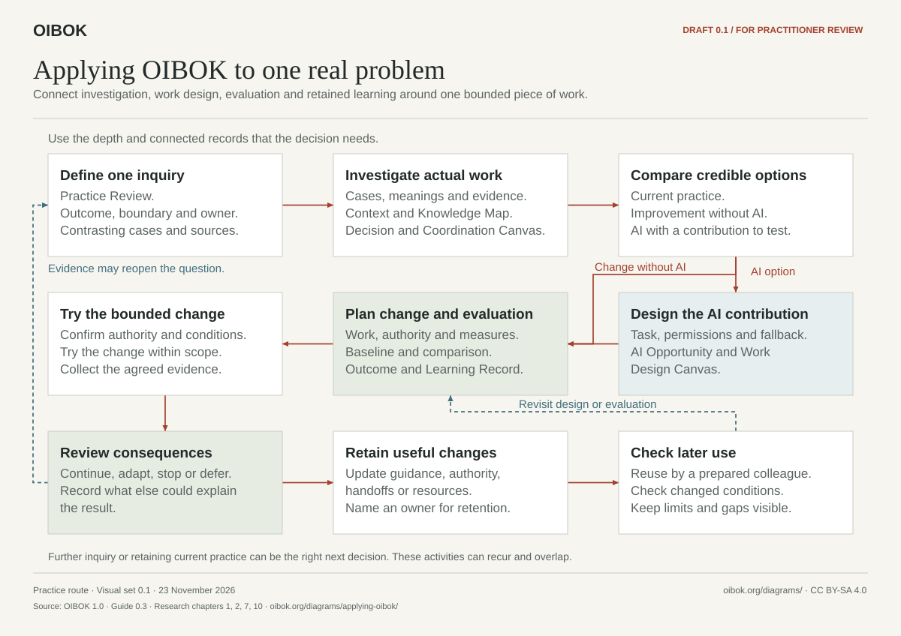
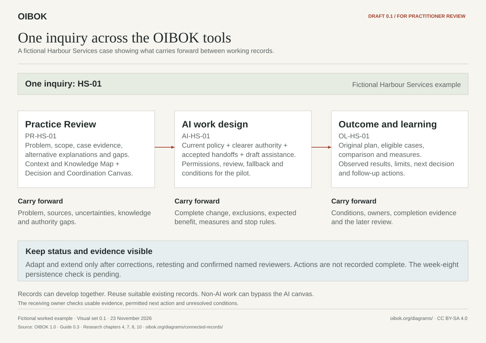
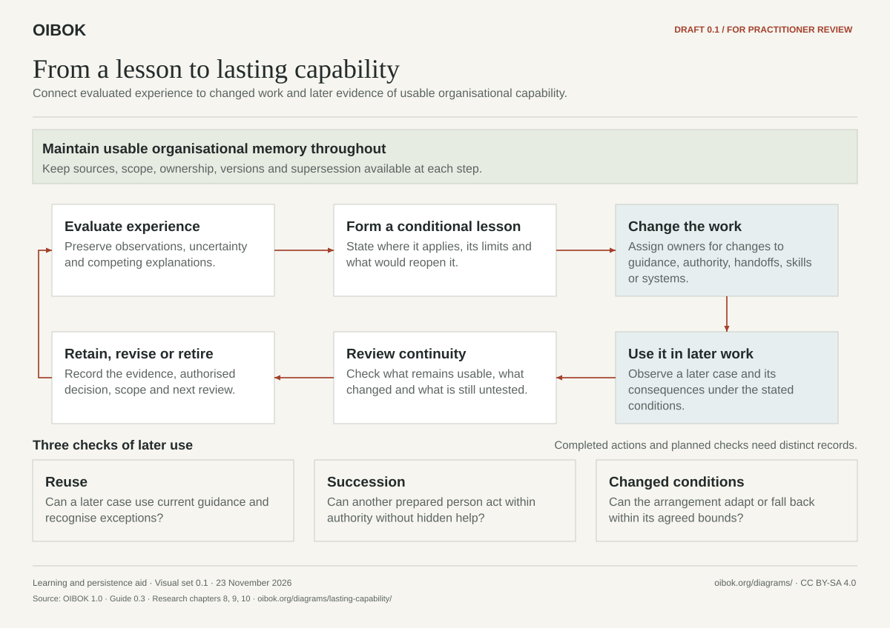

# OIBOK Working Companion

**Preparing and reviewing practical use**

Companion 0.6

DRAFT · For practitioner review

24 November 2026

Organisation Intelligence Body of Knowledge

[oibok.org](https://oibok.org/)

## Purpose and status

Use this companion with Guide 0.6 to prepare a review, connect the working records and return useful feedback. It provides a route selector, preparation prompts, annotated fictional excerpts, a diagnostic sheet, a record for exceptions and changes of owner, a cross-team decision sheet and an editable practitioner feedback record. It does not replace the five Practical Toolkit canvases.

The illustrated guide and companion are edition 0.6. Their figures are draft Visual set 0.1. The five blank fillable A3 canvases remain **Practical Toolkit 0.1**, unchanged. The research baseline remains **OIBOK release 1.0**. Sources are recorded in section 7.

This edition is prepared for practitioner review. No external reviewer has been contacted for this pack. Independent practitioner review, walkthroughs and field testing remain pending. The blank feedback record is a means of collecting evidence, not a completed review or a validation claim.

## 1 Choose the depth of the review

Choose the smallest review that can support the decision. Consider consequences, reversibility, dependencies and uncertainty. These routes are proposed starting points, with no readiness score. Revisit the route when the work or its consequences change.

The common minimum is the [Practice Review](https://oibok.org/tools/practice-review/) and, for a selected change, the [Outcome and Learning Record](https://oibok.org/tools/outcome-and-learning/). Expand the supporting Context and Knowledge Map and Decision and Coordination Canvas where gaps matter. Name an owner for retention and the later review. Add the [AI Opportunity and Work Design Canvas](https://oibok.org/tools/ai-opportunity-and-work-design/) when AI is taken forward into work design or a pilot. If AI is deferred during the initial review, record the reasons in the Practice Review; a full AI canvas is not yet needed. Roles may be combined where appropriate, while applicable separation of responsibilities remains. See the [Toolkit Guide](https://oibok.org/tools/guide/) for tool selection.

### Small reversible change

| Detail | Starting point |
| --- | --- |
| Scope | A bounded adjustment within existing authority. |
| People | Work owner, someone performing the work and its recipient; relevant expertise when needed. |
| Connected record | Inquiry, contrasting cases, sources, competing explanations, proposed change and authority; outcome check, action owner and review point. |
| Next decision | Try the limited change, investigate further or retain current practice. |
| Deepen the review | Authority is unclear, effects extend beyond the boundary, reversal is uncertain or affected people identify a material consequence. |

### Bounded AI pilot

| Detail | Starting point |
| --- | --- |
| Scope | A defined AI contribution within a reviewed workflow. |
| People | Work owner, workers, knowledge owner, systems support and evidence owner; affected users where relevant. |
| Connected record | Practice Review; AI canvas with alternatives, information boundaries, permissions, review, fallback and stop conditions; evaluation plan and learning record. |
| Next decision | Authorise a limited pilot when conditions are evidenced, choose a non-AI change, investigate or stop. |
| Deepen or escalate | Evidence or permissions are missing, review capacity is inadequate, an action exceeds delegation or a stop condition occurs. |

### Consequential work across teams

| Detail | Starting point |
| --- | --- |
| Scope | Interdependent commitments or effects that are difficult to reverse. |
| People | Accountable decision owner, affected workflow owners and recipients, specialists and evidence owner; independent challenge where warranted. |
| Connected record | Case evidence, dependencies and decision rights, affected outcomes, options, resources and existing approvals; recovery, evaluation and retention responsibilities. |
| Next decision | Make a bounded commitment, commission further inquiry, adapt the proposal or defer it. |
| Deepen or escalate | Ownership or competing constraints remain unresolved, consequences exceed authority, or evaluation and recovery need specialist support. |

**Figure. Applying OIBOK to one real problem.** Draft practice illustration. Connect the inquiry, working records, chosen change and evaluation. AI is optional. Revisit earlier questions when evidence or conditions change; further inquiry and retaining current practice remain legitimate decisions. [Open the figure and full-size downloads](https://oibok.org/diagrams/applying-oibok/).

### Open the route and completed records

The [Guide route reference](https://oibok.org/guide/read/#from-a-question-to-a-recorded-decision) connects each stage to the reading, participants, worksheet and output. Keep one case identifier as information moves between records.

The [Silvergum worked case pack](https://oibok.org/guide/silvergum/) provides a completed Practice Review with Context and Knowledge Map and Decision and Coordination Canvas, diagnostic record DG-SG-01, Outcome and Learning Record OL-SG-01, exception EX-SG-01, ownership transfer EX-SG-02 and cross-team decision CT-SG-01. All records and figures are fictional. The blank sheets below remain available for your own work.

## 2 Prepare one connected inquiry

Copy the relevant blanks into your authorised workspace. Keep the worked examples separate. Their assumptions, targets and decisions are fictional and should not become defaults for your organisation.

Agree the question, boundary, decision owner and intended use of the review. Bring contrasting cases, instructions available at the time, handoff and decision records, and outcome information. Record why cases were selected and what is inaccessible or missing. Invite someone who receives the work to explain what was usable. Provide a route for concerns that should not be attributed in a shared worksheet. These prompts adapt the [Practice Review](https://oibok.org/tools/practice-review/).

### Case index

Use one identifier across the records. The empty cells are for your inquiry. Add rows or link an existing index if it already serves this purpose.

| Field | Entry |
| --- | --- |
| Case identifier and date | |
| Inquiry and intended outcome | |
| Start, end and exclusions | |
| Decision owner and authority | |
| Guide, companion and toolkit editions used | |
| Working record locations and revisions | |
| Missing evidence and responsible owners | |
| Current status and next review | |

Keep sensitive source material in its authorised location and reference it by identifier. Do not create a second uncontrolled copy merely to complete the index.

## 3 Carry the records forward

The records can develop together. These handoffs check continuity; they are not a compulsory sequence.

**Figure. One case across the OIBOK working records.** Draft fictional Harbour Services illustration. A shared case identifier connects evidence, design, evaluation and later actions. Records can develop together. Preserve proposed arrangements, conditional authorisation, completed work and pending checks as distinct statuses. Harbour follow-up corrections and its week-eight persistence check remain pending. [Open the figure and full-size downloads](https://oibok.org/diagrams/connected-records/).

### Review to work design

Carry the problem, boundary, sources, competing explanations, knowledge and authority gaps, and proposed improvement. The receiving owner checks whether the design addresses the reviewed work and whether unresolved dependencies have owners. When AI proceeds into work design, carry these entries into the [AI canvas](https://oibok.org/tools/ai-opportunity-and-work-design/).

### Design to evaluation

Carry the complete intervention, eligible cases, exclusions, expected benefit, comparison, measures, permissions and stop rules. The evidence owner checks definitions, sources and collection responsibilities before the change begins. A non-AI change can move directly from the Practice Review into the [Outcome and Learning Record](https://oibok.org/tools/outcome-and-learning/).

### Results to continuing practice

Carry observations, missing outcomes, limits, the decision, corrective actions, current instructions and the later review. The receiving owner checks completion evidence and whether people can use the revised arrangement. A planned test remains planned until its result is recorded. Retain the original plan and date later changes. See the [Outcome and Learning Record](https://oibok.org/tools/outcome-and-learning/).

Before handing over, ask the receiving person to locate the evidence, explain the permitted next action and identify outstanding conditions. Record entries as proposed, awaiting evidence, authorised, completed or reviewed as appropriate. Give the later persistence check an owner.

**Figure. From a lesson to lasting capability.** Draft practice illustration. A lesson becomes useful through owned changes to working arrangements and later enactment. Reuse, succession and changed conditions provide different evidence about continuity. Record what remains untested and distinguish an action completed from capability demonstrated later. [Open the figure and full-size downloads](https://oibok.org/diagrams/lasting-capability/).

## 4 Read the worked examples

The linked Harbour Services working records contain fictional teaching material. Use them as worked examples and start organisational work from the blank canvases. Case **HS-01** connects **PR-HS-01**, **AI-HS-01** and **OL-HS-01**. All organisations, records, figures and results in this case are invented. The excerpts below add annotations without adding results or completing pending actions.

### Evidence and explanation

The [Practice Review](https://oibok.org/tools/practice-review/) records this staff account in B3:

> Staff describe inconsistent policy access, unclear refund authority and context lost between teams.

Its accompanying limit is:

> Reported experience. Frequency and relative contribution need investigation.

**Read the distinction.** B3 is a participant account. The separate fictional B1 audit records incomplete handoffs in 32 of 100 baseline cases. Neither entry establishes the cause. Workload, case mix and skills remain explanations to investigate alongside knowledge and authority.

**Apply the prompt.** In your record, can another reader distinguish what happened, what somebody reported, what you infer and what is unknown?

### Design and evidence

The [AI canvas](https://oibok.org/tools/ai-opportunity-and-work-design/) specifies:

> A named adviser checks the cited source, version and proposed response before every external reply. AI cannot send, approve refunds, change policy or take external action.

**Read the distinction.** This states the intended control and authority. It does not establish that reviewers are prepared or that the control works. Tests of sources, permissions, exceptions, abstention and fallback remain conditions requiring evidence.

**Apply the prompt.** Which entry is a proposed arrangement, which records authorisation, and where will completed test evidence be found?

### Results and conditional action

The [Outcome and Learning Record](https://oibok.org/tools/outcome-and-learning/) states:

> AI drafts contained unsupported policy claims in 3/20 package cases. Review caught all before sending: one used a superseded policy and two misapplied exception wording.

**Read the distinction.** Draft defects and final customer-facing errors are different observations. Zero final policy errors in twenty fictional cases does not establish reliability. The combined package cannot isolate AI's contribution. The decision to adapt and extend remains conditional on corrections, retesting and confirmation of reviewers. The later check at week eight remains pending.

**Apply the prompt.** Keep the result, decision conditions, completion evidence and persistence finding separately identifiable.

### Other examples in the guide

Alongside Harbour Services, the Guide includes Linden Studio, Wattle Supply and Silvergum Field Services. Linden Studio examines a client onboarding handoff and ends with a proposed change without AI; outcomes remain pending. Wattle Supply compares assumed catalogue-work resources with and without AI. Its baseline and alternatives are planning assumptions, with no observed results. It distinguishes potential released capacity from cash saving and shows how longer review can change the preferred option. Neither example supplies additional Harbour evidence.

### Run a diagnostic review

Use this sheet inside the Practice Review. Begin with the consequence and ask the people on either side of the disputed event to reconstruct one difficult case and one contrasting case. Refer to Guide Chapter 2A when choosing which explanation to examine. Complete a row only when it changes the next decision.

| Question | Your case notes |
| --- | --- |
| What did the recipient or customer experience? Which case, date and source show it? | |
| At which event did the two accounts diverge? What was available to each person then? | |
| Which failure class offers a useful explanation? Which alternative would imply a different change? | |
| What would you expect to see if each account were true? Who can obtain that evidence? | |
| Which case weakens the leading explanation? What remains uncertain? | |
| What will the owner authorise now? What result would change that decision? | |

**Worked entry from fictional case SG-01.** Sales called the Monday quote approved when the customer agreed. Scheduling could see the superseded version. The leading explanation was a failure in the handoff. Crew shortage also explained some delays. The next check separated time before scheduling acceptance from time waiting for a crew afterwards. The service owner authorised a local trial for returned packets and kept crew capacity as a separate inquiry.

### Record an exception and transfer ownership

Use this record when an exception occurs or the person sustaining a change leaves the role. The original evaluation plan and the first result should remain available for a later reader. Record the condition that failed, what actually happened, what the fallback achieved and the authority for restarting.

| Field | Your case notes |
| --- | --- |
| Case, observation window and original decision or pause condition | |
| Exception, consequence, immediate containment and person contacted | |
| Changed instruction or access, accountable owner and evidence of completion | |
| Incoming owner, delegated authority, location of guidance and recovery route | |
| Evidence from a rehearsal and from later ordinary work, with dates | |
| Result for customers and staff, competing explanation and next review | |

**Worked entry from SG-01.** The Coast relief lead could read an accepted job but could not reopen it. During rehearsal the duty manager used the existing delegation to reopen it and corrected role access. Later, two live amendments showed the incoming lead obtaining a second acceptance without the original lead. The monthly review still had to consider case mix and scope-related rebooking.

### Agree the cross-team decision

Put one case from each team side by side before comparing rates. Enter the local meaning of each event, the population included, who can change the work and who carries any new cost. Use the director's decision in Guide Chapter 8 as a worked example.

| Decision to record | Evidence and owner |
| --- | --- |
| What the teams mean by the same word and how to compare equivalent events | |
| A common rule both receivers need, and the person authorised to set it | |
| What each team will test locally, including local exceptions and limits | |
| A conflict that needs a wider decision, and to whom it goes | |
| Evidence required before another team adopts the change | |

In SG-01 the director owned the three common event definitions. Coast owned the revised scope handoff. Ranges retained its remote scheduling window and examined the promises made to customers. Each service owner brought a local outcome record back to the director.

### Prepare for difficult sessions

[Guide Appendix B](https://oibok.org/guide/facilitation/) includes questions and completed decision records for conflicting accounts, missing evidence, absent authority, a preselected AI option and work shifted to another team. Before the session, identify the decision owner and the receiver who will carry the outcome into work. At close, read back the decision, limits, owner and next evidence.

## 5 Review the guide in practice

Choose a section and a useful question. You do not need to read the entire guide or implement a change to offer feedback. Record the activity that supports each finding.

| Activity | What the record can support |
| --- | --- |
| Reader feedback | A reader's judgement about clarity, relevance or missing content. |
| Observed walkthrough | Usability in the task observed, including help required. |
| Live application | Use and usefulness in a stated setting with its adaptations and support. |
| Outcome review | A bounded finding about consequences supported by measures, comparison and limits. |
| Persistence review | Evidence of later use or continuity over a stated period. |

For a walkthrough, use an authorised case and observe hesitation, misinterpretation, missing information, assistance and the resulting artefact. Record what the practitioner does as well as what they say. Record any author, facilitator or AI explanation that affects what the exercise shows about independent use.

For live application, agree the owner and scope before changing work. Use the existing toolkit records and preserve the original plan. Include concurrent changes, local adaptations, extra support, difficulty and abandoned attempts. A useful discussion is not automatically an operational benefit. Outcome and persistence findings need separate evidence, consistent with [Outcomes Feedback and Evaluation](https://oibok.org/knowledge/outcomes-feedback-and-evaluation/) and [the OIBOK evidence architecture](https://oibok.org/knowledge/integrated-and-responsible-organisational-intelligence/).

## 6 Blank practitioner feedback record

Copy this record for each review. All response cells are intentionally empty. Type in the editable document or Markdown and expand the cells as needed. For handwriting, enlarge the response areas before printing or attach sheets carrying the review identifier and field name. Duplicate the finding block for separate issues. Use **Not yet examined** for an unexamined question and **Not applicable** with a reason where appropriate. Do not treat an empty cell as evidence that no problem occurred.

### Review identity

| Field | Response |
| --- | --- |
| Review identifier and date | |
| Guide version and section or passage | |
| Companion and tool versions used | |
| Reviewer role and relationship to the project | |
| Organisation or deidentified setting | |
| Workflow, intended users and question | |
| Activity type and scope | |

### What was attempted

| Field | Response |
| --- | --- |
| Intended result and relevant constraints | |
| Available records and missing information | |
| Instructions followed and local adaptations | |
| Facilitator, author or AI assistance received | |
| Preparation and working effort | |
| Resulting artefact or source reference | |

### Finding

| Field | Response |
| --- | --- |
| Observation or reported experience | |
| Supporting source, date and coverage | |
| Interpretation and competing explanation | |
| Uncertainty or contradictory evidence | |
| What became clearer, remained blocked or changed | |
| Burden, adverse effect or affected perspective | |
| Resulting decision and accountable owner | |
| Proposed correction to the guide | |

### Later evidence

| Field | Response |
| --- | --- |
| Whether outcome, persistence or neither was examined | |
| Observation period; eligible, observed and missing cases | |
| Measures, comparison and evidence location | |
| Changed conditions and limits on attribution | |
| Later reuse, succession or continuity evidence | |
| Remaining question, owner and next review | |

### Sharing and follow up

| Field | Response |
| --- | --- |
| Material authorised for disclosure and restrictions | |
| Attribution preference | |
| Permission and contact route for clarification | |

### Editorial use

Leave these fields for the person assessing the submission. A proposal remains a proposal until its editorial decision is recorded.

| Field | Response |
| --- | --- |
| Issue reference, evidence type and review date | |
| Editorial decision and rationale | |
| Accepted change and guide version or reason deferred | |
| Responsible editor and follow up | |

Use the [contribution process](https://oibok.org/contribute/) or [info@oibok.org](mailto:info@oibok.org) to provide authorised feedback. Public submissions should contain only material authorised for publication. Identify evidence limitations and distinguish a proposed source correction from a research question. The [governance page](https://oibok.org/governance/) explains editorial responsibility.

## 7 Sources and rights

This companion uses **OIBOK release 1.0**, dated 15 August 2026, and **Practical Toolkit 0.1**, dated 22 November 2026. Research chapter component labels remain 0.3 within release 1.0. See the [release record](https://oibok.org/research/release-record/) and [Toolkit Guide](https://oibok.org/tools/guide/).

The source snapshot is [repository revision 5036b4aa](https://github.com/IntentEffect/OIBOK/tree/5036b4aa36f3b643f20992feb30676c0e527b319), examined on 23 November 2026. Live links may change after that date. The annotations adapt the OIBOK original Harbour records in the linked Practice Review, AI canvas and Outcome and Learning Record. They add explanation, not new findings. Preparation used AI assistance; practitioner and field testing remain pending. Companion 0.3 introduced selected draft figures from Visual set 0.1 to make the application route, connected records and later learning easier to inspect. The figures add no new results.

Companion 0.6 adds editable diagnostic, exception and ownership-transfer, and cross-team decision records. Silvergum Field Services is an original fictional example linked to Guide Chapter 2A, Chapter 8 and Appendix A4. Its events and figures are invented. The 0.6 editorial source baseline is [revision b8f4e0f0](https://github.com/IntentEffect/OIBOK/tree/b8f4e0f000a75169ff27084fed3a6467696eed64) (24 November 2026).

Publication content is licensed under [Creative Commons Attribution ShareAlike 4.0 International](https://creativecommons.org/licenses/by-sa/4.0/), unless separately marked. Contributors retain copyright and license their original publication contributions under these terms. See [licensing and reuse](https://oibok.org/licensing/) for scope and exceptions. Retain original supplied notices with the canvases and excerpts, credit the OIBOK original records and identify adaptations. This companion does not modify the licence terms.

Suggested credit: Organisation Intelligence Body of Knowledge, OIBOK Working Companion 0.6, connected practice edition, 24 November 2026, oibok.org, CC BY-SA 4.0. Retain any additional attribution supplied with the source material.
